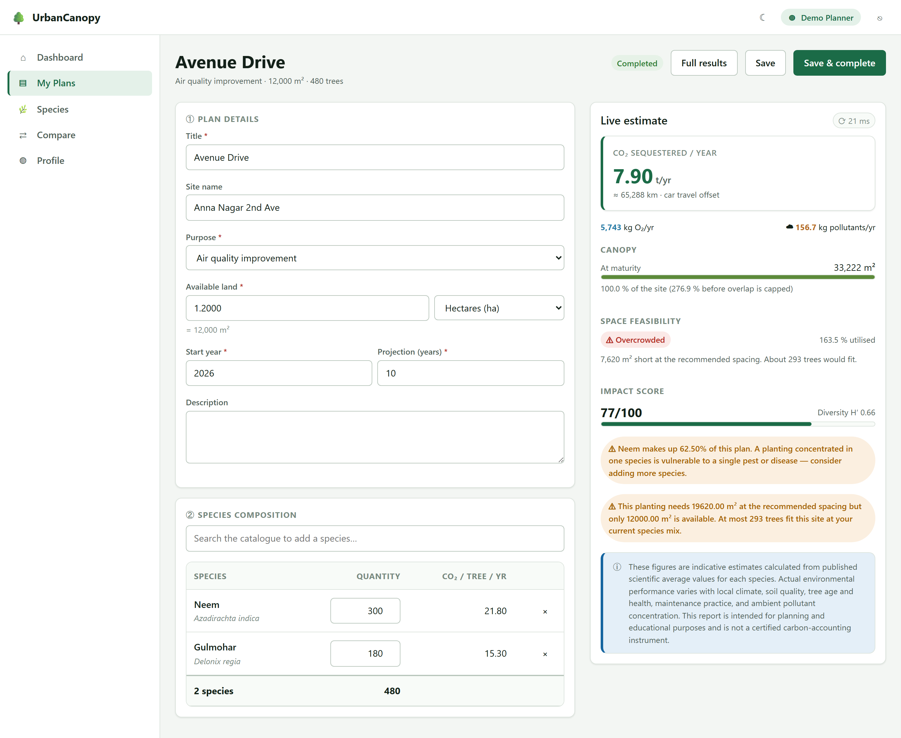
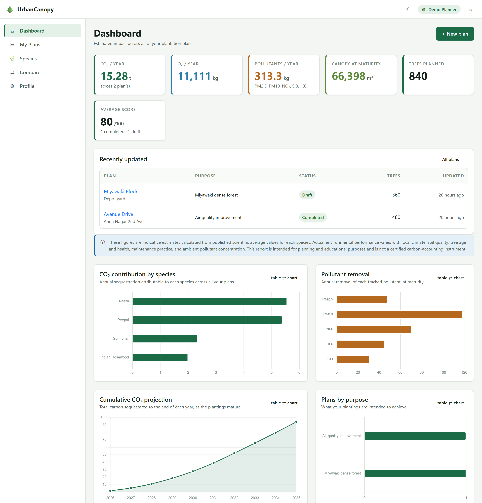
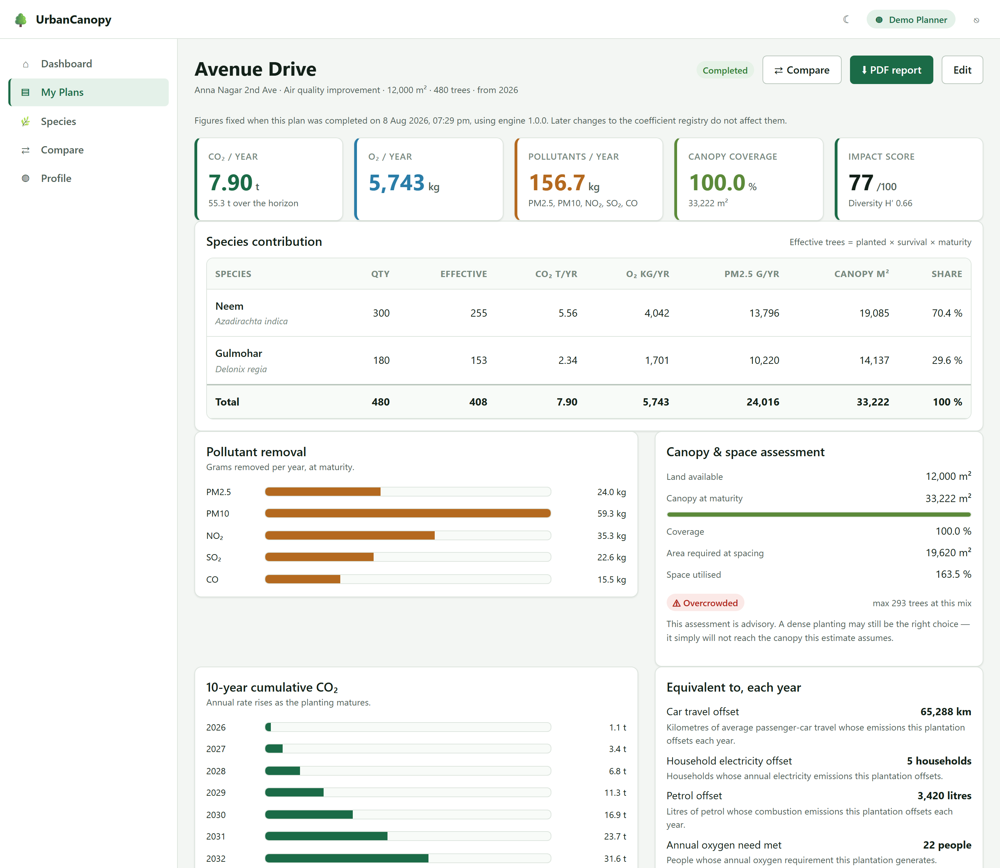
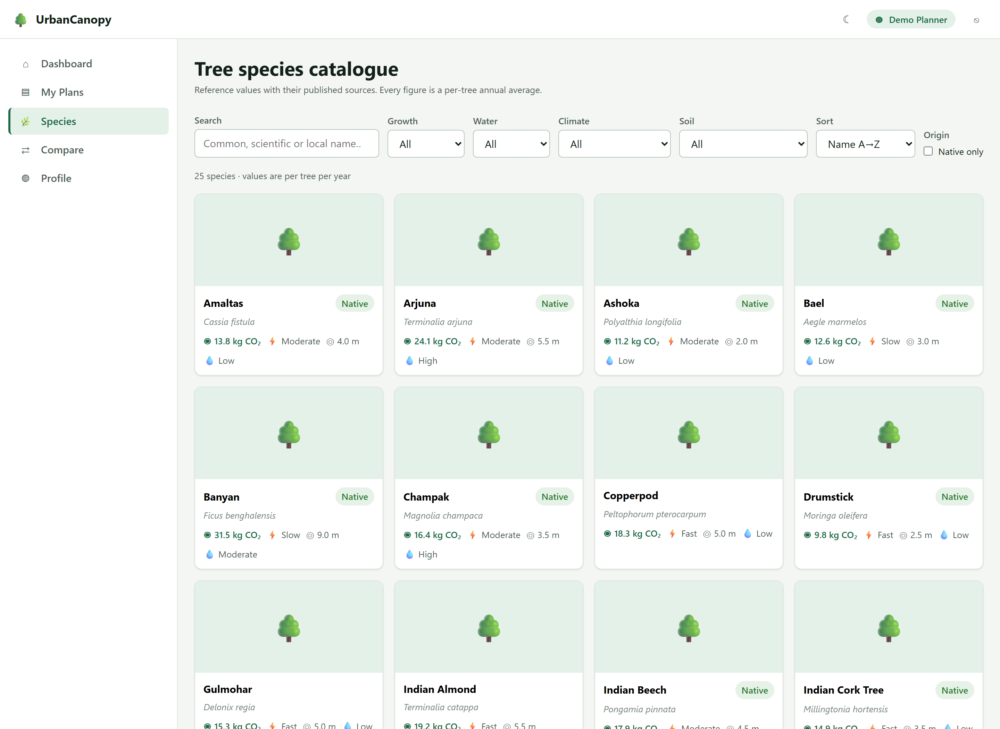
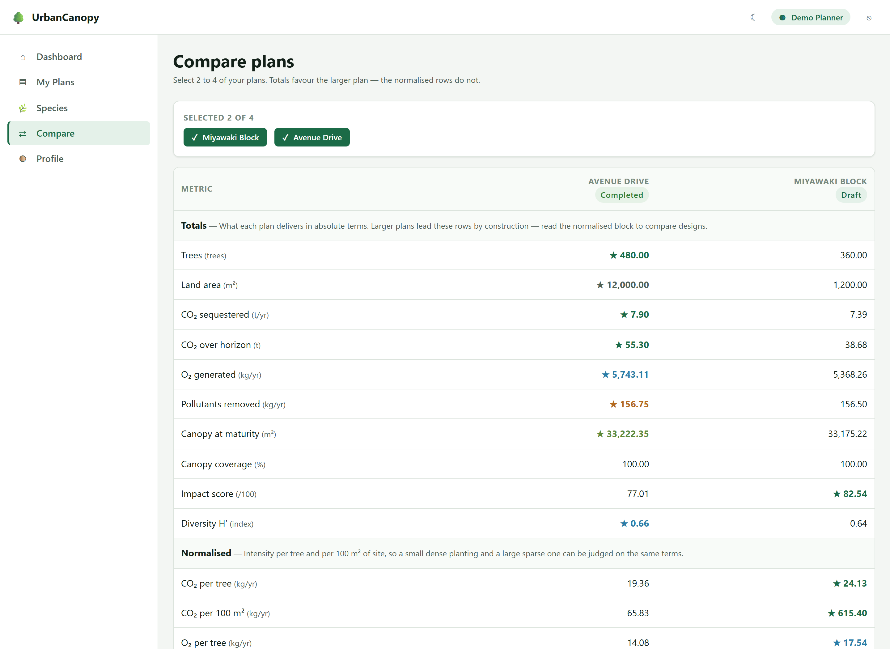

# UrbanCanopy

**Urban tree plantation planning with estimated annual carbon sequestration and air-quality
impact.**

Compose a planting from a sourced species catalogue and get its annual CO₂ sequestration,
oxygen generation, pollutant removal, canopy coverage and spatial feasibility — computed from
published scientific averages, with every figure traceable to the values and arithmetic behind
it.

---

## The problem

A city decides to plant two thousand trees. Which species, how many of each, and what will it
actually achieve?

In practice that decision is usually made on availability, cost and appearance, because the
environmental answer is genuinely hard to get at:

- **The numbers are scattered.** Per-species sequestration and pollutant-removal rates exist in
  the literature, but assembling them into a figure for *this* planting on *this* site means a
  spreadsheet somebody built once and nobody can audit.
- **Planting counts are not outcomes.** "Two thousand trees" says nothing about carbon, and
  quietly ignores that not every sapling survives and none of them perform at full capacity for
  years.
- **Bigger always looks better.** Comparing two proposals on totals rewards whichever plants
  more trees, which is not the same as the better design.
- **Space is assumed, not checked.** A mix that needs 19,600 m² at its recommended spacing does
  not fit on 12,000 m², and nothing in a species list makes that visible until the canopy fails
  to close.
- **Nobody can check the working.** A figure in a proposal with no stated source, no assumptions
  and no arithmetic is not evidence — and it is exactly the kind of number that gets quoted for
  years.

**UrbanCanopy makes that estimate explicit, sourced and reproducible.** It applies survival and
maturity adjustments so the headline reflects trees that live rather than trees that were
planted; it assesses whether the planting physically fits; it normalises comparisons per tree
and per 100 m² so size cannot masquerade as quality; and it shows the arithmetic and cites the
literature behind every value. When a plan is completed, the constants that produced its figures
are frozen with it, so a report quoted in March still reconciles in December.

It is a planning and educational instrument, not a certified carbon-accounting one — and it says
so on every screen and in every document that shows a computed value.

---

## What it does

| | |
|---|---|
| **Plan** | Describe a site and compose a species mix, with a live estimate that updates as you type — no page reload, no half-built plans written to the database |
| **Estimate** | CO₂ and O₂ per year, PM2.5/PM10/NO₂/SO₂/CO removal, canopy area and coverage, spatial feasibility, a 0–100 impact score, species diversity, and a multi-year projection |
| **Explain** | Every result carries a calculation trace — the arithmetic with the real numbers substituted — and a literature citation for every species |
| **Compare** | Two to four plans side by side, with per-tree and per-100 m² intensities so a large plan cannot win merely by being large |
| **Report** | A multi-page PDF: cover, composition, per-species contribution, canopy assessment, projection, equivalences, and a methodology appendix |
| **Administer** | Curate the species catalogue, revise the scientific coefficients without a redeploy, manage accounts, and read the audit and report logs |

**Figures are estimates.** They come from published per-species averages adjusted for expected
survival and maturity, not from measurements at your site. Every screen and document that shows
a computed value says so.

---

## Screens

### The plan editor

The core screen. A live estimate recalculates as you type — the `⟳ 21 ms` chip shows the round
trip, because a claim of "live" is worth more when it is visible. Nothing is written to the
database until you save, so an unsaved composition can still be evaluated.

Note what it is willing to tell you: the canopy is capped at 100 % of the site but the true
276.9 % is still stated, the planting is flagged **Overcrowded** with the shortfall and how many
trees would actually fit, and a monoculture warning appears because one species is 62.5 % of the
mix. All of it advisory — none of it blocking.



### Dashboard

Aggregated across every plan, with each chart paired with a toggleable data table so no figure
is carried by a picture alone.



### Plan results

The full breakdown: per-species contribution, pollutant removal, canopy and feasibility
assessment, the multi-year projection, relatable equivalences, and an *"How is this
calculated?"* drawer showing the arithmetic with real numbers substituted.



### Species catalogue and comparison

<p align="center">
  
  
</p>

Twenty-five species with sourced reference values; comparison of two to four plans with
normalised per-tree and per-100 m² rows, so a larger plan cannot win merely by being larger.

---

## Quick start

### Prerequisites

- **JDK 21+** (the build targets Java 21 bytecode; it compiles and runs on later JDKs)
- **MySQL 8.0.16+** (the schema uses `CHECK` constraints)
- **Maven 3.9+**

### 1. Configure the database

The application creates its own schema on first run. It needs a MySQL account that may create
databases, supplied through environment variables:

```bash
export DB_HOST=localhost     # default: localhost
export DB_PORT=3306          # default: 3306 — set this if your MySQL is on another port
export DB_NAME=urban_canopy  # default: urban_canopy
export DB_USERNAME=root
export DB_PASSWORD=your-password
```

On Windows PowerShell:

```powershell
$env:DB_PORT="3306"; $env:DB_USERNAME="root"; $env:DB_PASSWORD="your-password"
```

### 2. Run

```bash
mvn spring-boot:run
```

Then open **<http://localhost:8080>**.

Flyway creates the schema and seeds 25 tree species, 21 environmental coefficients and two
accounts on first start.

### 3. Sign in

The seeded accounts ship **without a usable password** — the seed migration writes a
placeholder, because SQL cannot compute a BCrypt hash and committing one would be a backdoor.
The `dev` profile supplies a password so a fresh checkout is usable immediately:

| Account | Email | Password |
|---|---|---|
| Planner | `planner@urbancanopy.local` | `Planner@123` |
| Administrator | `admin@urbancanopy.local` | `Planner@123` |

The application logs a loud warning naming every account it opens this way.

> **Before deploying anywhere real:** run under the `prod` profile, where no seed password is
> configured. Left unset, the seeded accounts simply cannot authenticate — an installation with
> no usable administrator is recoverable; one with a publicly known administrator password is
> not. Set `UC_SEED_PASSWORD` once, sign in, and change it.

### 4. Test

```bash
mvn test
```

**87 tests.** They need no database and no running server: the repository tests use an in-memory
H2 instance, and everything else is a unit or slice test.

---

## Technology

| Layer | Choice | Why |
|---|---|---|
| Backend | Spring Boot 3.5, Java 21 | — |
| Persistence | Spring Data JPA + MySQL 8 | |
| Schema | Flyway versioned migrations, `ddl-auto=validate` | Reviewable SQL; the application refuses to start if entities and schema drift |
| Security | Spring Security, BCrypt, session + CSRF | |
| PDF | OpenPDF | LGPL/MPL — safe to submit and to commercialise, unlike AGPL iText 7 |
| Frontend | Static HTML + vanilla ES modules, Bootstrap 5, Chart.js | No bundler, no framework — a clean API boundary |
| Numbers | `BigDecimal` end to end, serialised as JSON **strings** | JavaScript would silently round a 16-digit figure into a report |

Bootstrap and Chart.js are **vendored locally**, so the application runs with no internet access.

---

## Project structure

```
src/main/java/com/urbancanopy/
├── calculation/     THE DOMAIN CORE — pure, no Spring, no JPA, no I/O
│   ├── component/       one calculator per concern
│   └── model/           immutable inputs and results
├── plan/            plantation plans: entity · repository · service · dto · mapper · controller
├── species/         the reference catalogue
├── coefficient/     the tunable scientific constants
├── dashboard/       read-only aggregation
├── report/          PDF generation and the report log
├── user/            accounts, registration, authentication
├── audit/           the audit trail
├── common/          cross-cutting: dto · exception · security seam · util
└── config/          typed configuration, security, JPA auditing, web

src/main/resources/
├── db/migration/    V1 schema · V2 seed data · V3 timestamp correction
└── static/          the browser client (15 pages, 25 ES modules)
```

**The dependency rule:** `controller → service → { calculation-engine, repository } → entity`.
A controller never touches a repository. A service never returns an entity across the web
boundary. The calculation engine depends on nothing — not Spring, not JPA, not the database —
which is what makes the scientific core testable with a plain JUnit test.

---

## Two things that shaped the design

**The calculation engine is pure.** It accepts a value object and returns a value object,
performing no persistence and no I/O. That single constraint is why the live editor can estimate
a plan that has not been saved, why a completed plan can be re-evaluated against the coefficients
frozen when it was completed, and why 23 tests exercise the whole scientific core in
milliseconds.

**Nothing scientific is hardcoded.** Survival rates, maturity periods, feasibility thresholds,
equivalence factors and scoring weights are rows in a table an administrator can edit at
runtime. Each carries its own plausible range, its published source, and its seeded default so
any change can be undone. Adding a new equivalence — "this offsets N domestic flights" — is one
database row and no Java at all.

---

## Documentation

| Document | Contents |
|---|---|
| [`docs/01-requirements-and-use-cases.md`](docs/01-requirements-and-use-cases.md) | Functional requirements, use cases, business rules |
| [`docs/02-system-architecture.md`](docs/02-system-architecture.md) | Layering, package structure, request flow, the security seam |
| [`docs/03-database-schema.md`](docs/03-database-schema.md) | ER diagram, tables, constraints, indexing |
| [`docs/04-ui-wireframes-and-design-system.md`](docs/04-ui-wireframes-and-design-system.md) | Screens, design tokens, accessibility |
| [`docs/05-api-reference.md`](docs/05-api-reference.md) | Every endpoint, with conventions and error codes |
| [`docs/06-implementation-and-traceability.md`](docs/06-implementation-and-traceability.md) | What was built, and every requirement traced to its code and its test |

---

## Troubleshooting

**`Failed to determine a suitable driver class`, or `0 JPA repository interfaces` at start-up**
— `target/` is in an inconsistent state, usually because a build was interrupted. Delete it and
rebuild:

```bash
rm -rf target && mvn test
```

**`Port 8080 was already in use`** — a previous instance is still running. Stop it, or set
`SERVER_PORT` to something else.

**Flyway reports a checksum mismatch** — an already-applied migration was edited. Migrations are
immutable once applied; add a new one instead. (`V3` in this project exists for exactly that
reason.)

---

## Licence

[MIT](LICENSE) © 2026 Aswin Senthilkumar

Vendored third-party assets keep their own licences: Bootstrap 5 (MIT), Chart.js (MIT) and
OpenPDF (LGPL/MPL — chosen over iText 7 precisely because AGPL would have reached the whole
application).
