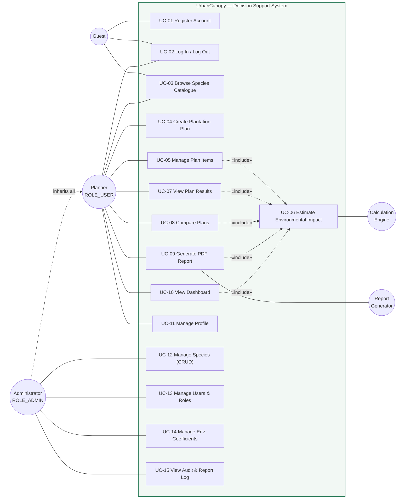

# Phase 1 — Functional Requirements & Use Cases

**Project:** Urban Tree Plantation Plan to Estimate Annual Carbon Sequestration and Improve Air Quality
**Working name:** UrbanCanopy
**Document version:** 1.0
**Phase:** 1 of 14 — Requirements Engineering

---

## 1. Executive Summary

UrbanCanopy is a **web-based decision-support system (DSS)** that helps urban planners,
municipal bodies, NGOs, educational institutions and citizens design tree-plantation
plans and quantify their expected environmental benefit **before** a single sapling is
planted.

The system does **not** predict, sense, or map anything. It is a **deterministic
estimation engine**: the user describes a plantation (which species, how many, on how
much land), and the system multiplies those quantities against **peer-reviewed
per-species reference values stored in the database** to produce annual and multi-year
estimates of carbon sequestration, oxygen generation, air-pollutant removal and canopy
coverage.

### 1.1 What the system IS

| Aspect | Description |
|---|---|
| Category | Decision-support / environmental estimation web application |
| Method | Arithmetic aggregation over stored scientific reference coefficients |
| Data source | Admin-curated species database + admin-curated global coefficients |
| Output | Quantified estimates, comparisons, dashboards, PDF reports |
| Determinism | Same input ⇒ same output, always. Fully explainable and auditable. |

### 1.2 What the system is NOT (explicit non-goals)

| Not this | Why it is excluded |
|---|---|
| AI / ML prediction | No model training, no inference. All maths is transparent arithmetic. |
| GIS / mapping system | No spatial layers, no coordinates, no polygons. Land area is a scalar in m². |
| IoT / sensor platform | No devices, no telemetry, no real-time air-quality feeds. |
| Live AQI monitoring | Pollutant figures are *removal potential*, not measured ambient concentration. |
| Certified carbon accounting | Estimates are indicative; not valid for carbon-credit trading or compliance. |

> **Scientific integrity requirement:** every screen and every report that displays a
> computed value must also display the estimation disclaimer (see FR-CALC-08).

---

## 2. Stakeholders & Actors

### 2.1 Actor catalogue

| # | Actor | Type | Description |
|---|---|---|---|
| A1 | **Guest** | Human, unauthenticated | Can view the public landing page, browse the read-only species catalogue, register, and log in. Cannot create or view plans. |
| A2 | **Planner (ROLE_USER)** | Human, authenticated | Primary actor. Creates and manages plantation plans, runs estimations, compares plans, downloads PDF reports, views a personal dashboard. |
| A3 | **Administrator (ROLE_ADMIN)** | Human, authenticated | Curates the scientific reference data (species, coefficients), manages user accounts, views system-wide analytics, audits activity. Inherits all Planner capabilities. |
| A4 | **Calculation Engine** | Internal subsystem | Stateless domain service invoked by the application to evaluate a plan against reference data. Not a user-facing actor, but modelled because it owns the core business rules. |
| A5 | **Report Generator** | Internal subsystem | Renders a computed plan snapshot into a paginated PDF document. |

### 2.2 Stakeholder concerns

| Stakeholder | Primary concern | Requirement it drives |
|---|---|---|
| Urban local body / municipality | "Will this drive-level plan meet our CO₂ target?" | Plan comparison, multi-year projection |
| NGO / campaign organiser | "Which species give the most benefit per rupee of land?" | Species efficiency ranking, canopy feasibility |
| Academic reviewer / examiner | "Where do these numbers come from?" | Source citation per species, methodology appendix in PDF |
| Administrator | "Reference values change as new literature appears." | Coefficients editable at runtime, never hardcoded |
| Auditor | "Who changed this coefficient and when?" | Audit fields on every entity, admin activity log |

---

## 3. Functional Requirements

Requirement IDs follow `FR-<MODULE>-<NN>`. Priority: **M** = Must have, **S** = Should
have, **C** = Could have (deferred if time-constrained).

### 3.1 Module 1 — Authentication & Account Management (`AUTH`)

| ID | Requirement | Priority |
|---|---|---|
| FR-AUTH-01 | A Guest shall register with full name, unique email, password and password confirmation. | M |
| FR-AUTH-02 | Passwords shall be stored only as BCrypt hashes; the plaintext shall never be logged, returned in a DTO, or persisted. | M |
| FR-AUTH-03 | The system shall enforce a password policy (minimum 8 characters, at least one letter and one digit) configured externally, not hardcoded. | M |
| FR-AUTH-04 | Registration shall reject a duplicate email with a field-level validation message, not a stack trace. | M |
| FR-AUTH-05 | A registered user shall log in with email + password via a form-login page. | M |
| FR-AUTH-06 | A logged-in user shall log out, invalidating the HTTP session and clearing the session cookie. | M |
| FR-AUTH-07 | Every new self-registered account shall be assigned `ROLE_USER`. `ROLE_ADMIN` shall be grantable only by an existing administrator. | M |
| FR-AUTH-08 | The system shall seed exactly one bootstrap administrator on first startup, with credentials supplied through external configuration. | M |
| FR-AUTH-09 | An authenticated user shall view and update their own profile (name, organisation, designation) and change their password by supplying the current one. | S |
| FR-AUTH-10 | An account shall carry an `enabled` flag; a disabled account shall be refused login with a clear message. | M |
| FR-AUTH-11 | Failed-login attempts shall be counted and the account temporarily locked after a configurable threshold. | C |
| FR-AUTH-12 | All state-changing requests shall be CSRF-protected. | M |

### 3.2 Module 2 — Tree Species Management (`SPEC`)

| ID | Requirement | Priority |
|---|---|---|
| FR-SPEC-01 | An Administrator shall create, read, update and soft-delete tree species records. | M |
| FR-SPEC-02 | Each species shall record **identity attributes**: common name, scientific (botanical) name, family, local/vernacular name, description, native flag. | M |
| FR-SPEC-03 | Each species shall record **environmental performance attributes**, each with an explicit unit: annual CO₂ sequestration (kg/tree/yr), annual O₂ generation (kg/tree/yr), PM2.5 removal (g/tree/yr), PM10 removal (g/tree/yr), NO₂ removal (g/tree/yr), SO₂ removal (g/tree/yr), CO removal (g/tree/yr). | M |
| FR-SPEC-04 | Each species shall record **horticultural attributes**: growth rate (SLOW / MODERATE / FAST), water requirement (LOW / MODERATE / HIGH), preferred climate zone, preferred soil type, mature canopy radius (m), average life span (years), recommended spacing between trees (m), mature height (m). | M |
| FR-SPEC-05 | Each species shall support an optional image (upload or URL) with server-side validation of content type and size, and a safe generated filename. | S |
| FR-SPEC-06 | Each species shall record the **literature source / citation** for its environmental values, so estimates are traceable. | M |
| FR-SPEC-07 | Scientific name shall be unique (case-insensitive); common name shall be unique. | M |
| FR-SPEC-08 | All numeric environmental attributes shall be constrained to be `>= 0`; canopy radius, spacing and life span shall be `> 0`. | M |
| FR-SPEC-09 | Any user (including Guest) shall browse a read-only, paginated, searchable species catalogue. | M |
| FR-SPEC-10 | The catalogue shall support filtering by growth rate, water requirement, climate zone, soil type, and native flag, and sorting by any environmental attribute. | S |
| FR-SPEC-11 | A species referenced by at least one plan shall not be hard-deleted; it shall be deactivated (`active = false`) so historical plans remain reproducible. | M |
| FR-SPEC-12 | Deactivated species shall be excluded from species pickers in the plan editor but shall still render correctly in existing plans and reports. | M |
| FR-SPEC-13 | The system shall seed a starter catalogue of at least 20 common Indian urban species with cited reference values on first startup. | M |
| FR-SPEC-14 | An Administrator shall bulk-import species from CSV with per-row validation and an error report. | C |

### 3.3 Module 3 — Plantation Planner (`PLAN`)

| ID | Requirement | Priority |
|---|---|---|
| FR-PLAN-01 | A Planner shall create a plantation plan with: title, description, site/location name (free text), available land area with unit (m² / hectare / acre), plantation purpose, target start year, and projection horizon in years. | M |
| FR-PLAN-02 | Plantation purpose shall be an enumerated, extensible value: `AIR_QUALITY_IMPROVEMENT`, `CARBON_OFFSET`, `URBAN_COOLING`, `NOISE_BARRIER`, `AESTHETIC_LANDSCAPING`, `BIODIVERSITY_RESTORATION`, `AVENUE_ROADSIDE`, `CAMPUS_GREENING`, `MIYAWAKI_DENSE_FOREST`. | M |
| FR-PLAN-03 | A plan shall contain one or more **plan items**, each pairing a species with a positive integer quantity. | M |
| FR-PLAN-04 | The same species shall not appear twice in one plan; adding a duplicate shall increment the existing quantity instead. | M |
| FR-PLAN-05 | A Planner shall add, edit and remove plan items, and shall save a plan as `DRAFT` before it is complete. | M |
| FR-PLAN-06 | A plan shall have a lifecycle status: `DRAFT` → `COMPLETED` → (optionally) `ARCHIVED`. Only a plan with ≥ 1 item and a positive land area may become `COMPLETED`. | M |
| FR-PLAN-07 | A Planner shall view a paginated list of their own plans, searchable by title and filterable by status and purpose. | M |
| FR-PLAN-08 | A Planner shall duplicate an existing plan as a new `DRAFT` (to explore an alternative species mix). | S |
| FR-PLAN-09 | A Planner shall soft-delete their own plans; soft-deleted plans shall disappear from listings and dashboards. | M |
| FR-PLAN-10 | A Planner shall access **only** their own plans. Any attempt to read or modify another user's plan shall yield HTTP 403, not 404-by-accident. | M |
| FR-PLAN-11 | An Administrator shall view any plan read-only for support and moderation purposes; this access shall be recorded in the audit log. | S |
| FR-PLAN-12 | Land area shall be captured in the user's chosen unit and normalised to m² for storage and calculation. | M |
| FR-PLAN-13 | The plan editor shall display a **live running estimate** that updates as items are added or quantities change, without a full page reload. | S |

### 3.4 Module 4 — Environmental Calculation Engine (`CALC`)

> Full formulae are specified in §6. This section states the *requirements*.

| ID | Requirement | Priority |
|---|---|---|
| FR-CALC-01 | The engine shall compute **annual CO₂ sequestration** (kg/yr and t/yr) for the whole plan and per species. | M |
| FR-CALC-02 | The engine shall compute **annual O₂ generation** (kg/yr) for the whole plan and per species. | M |
| FR-CALC-03 | The engine shall compute **annual removal of PM2.5, PM10, NO₂, SO₂ and CO** (g/yr and kg/yr), individually and as a total particulate/gaseous load. | M |
| FR-CALC-04 | The engine shall compute **canopy metrics**: total mature canopy area (m²), canopy coverage as a percentage of available land, and per-species canopy contribution. | M |
| FR-CALC-05 | The engine shall compute a **spatial feasibility assessment**: the land area required by the recommended spacing versus the land area available, yielding a verdict of `UNDER_UTILISED`, `OPTIMAL`, `TIGHT` or `OVERCROWDED`, with the surplus/deficit area and the maximum plantable count. | M |
| FR-CALC-06 | The engine shall apply **adjustment factors** — expected survival rate, a maturity/growth ramp factor derived from growth rate and tree age, and an optional site-condition factor — all sourced from the coefficients table, never hardcoded. | M |
| FR-CALC-07 | The engine shall produce a **multi-year projection** over the plan's horizon, giving cumulative CO₂ sequestered and the year-by-year annual rate as the trees mature. | M |
| FR-CALC-08 | Every screen, API response and report containing computed values shall carry a **methodology disclaimer** stating that figures are estimates derived from published scientific averages and will vary with local conditions. | M |
| FR-CALC-09 | The engine shall translate results into **relatable equivalences** (e.g. passenger-car-kilometres offset, households' annual electricity emissions, persons' annual oxygen need), using coefficients that an Administrator can edit. | S |
| FR-CALC-10 | The engine shall compute an **Environmental Impact Score (0–100)** as a weighted composite of carbon, air-quality, canopy and diversity sub-scores, with weights held in configuration. | S |
| FR-CALC-11 | The engine shall compute a **species diversity index** (Shannon–Wiener H′) and flag a monoculture risk when any single species exceeds a configurable share of the plan. | S |
| FR-CALC-12 | The engine shall be a **pure, stateless, side-effect-free** domain service: it shall accept a value-object input and return a value-object result, performing no persistence and no I/O, so it is trivially unit-testable. | M |
| FR-CALC-13 | All monetary-grade arithmetic shall use `BigDecimal` with an explicitly declared scale and `RoundingMode.HALF_UP`; `double` shall not be used for stored or reported values. | M |
| FR-CALC-14 | Computed results shall be **persisted as a snapshot** when a plan is marked `COMPLETED`, capturing the coefficient values in force at that moment, so a historical report is reproducible even after coefficients change. | M |
| FR-CALC-15 | The engine shall return a **calculation trace** (inputs, factors applied, intermediate subtotals) suitable for display in an "explain this number" panel and in the report appendix. | S |

### 3.5 Module 5 — Plan Comparison (`CMP`)

| ID | Requirement | Priority |
|---|---|---|
| FR-CMP-01 | A Planner shall select 2 to 4 of their own plans and view a side-by-side comparison. | M |
| FR-CMP-02 | The comparison shall cover total trees, land area, CO₂, O₂, each pollutant, canopy coverage %, impact score and diversity index. | M |
| FR-CMP-03 | The comparison shall highlight the best-performing plan per metric and compute **intensity metrics** (per-tree and per-100 m² normalisations) so plans of different sizes are fairly compared. | M |
| FR-CMP-04 | The comparison shall be visualised with a grouped bar chart and a radar chart, and shall be exportable to PDF. | S |

### 3.6 Module 6 — Dashboard & Analytics (`DASH`)

| ID | Requirement | Priority |
|---|---|---|
| FR-DASH-01 | A Planner shall see KPI cards for: total plans, completed plans, total trees planned, total annual CO₂ (t/yr), total annual O₂ (kg/yr), total annual pollutant removal (kg/yr), total canopy area (m²). | M |
| FR-DASH-02 | The dashboard shall render a **CO₂ contribution by species** chart (doughnut) across the user's plans. | M |
| FR-DASH-03 | The dashboard shall render a **pollutant removal breakdown** chart (horizontal bar) across PM2.5, PM10, NO₂, SO₂, CO. | M |
| FR-DASH-04 | The dashboard shall render a **cumulative CO₂ projection** chart (line) over the projection horizon. | M |
| FR-DASH-05 | The dashboard shall render a **plans by purpose** distribution chart. | S |
| FR-DASH-06 | The dashboard shall list the 5 most recently modified plans with quick links. | M |
| FR-DASH-07 | An Administrator shall additionally see system-wide KPIs: total users, active users, total species, total plans across all users, and the top 10 most-used species. | M |
| FR-DASH-08 | All dashboard data shall be delivered by JSON endpoints so charts render without a page reload; each endpoint shall be scoped to the caller's authorisation. | M |
| FR-DASH-09 | A dashboard with no data shall present a designed empty state with a call to action, never a blank chart canvas or an error. | M |

### 3.7 Module 7 — Reports (`RPT`)

| ID | Requirement | Priority |
|---|---|---|
| FR-RPT-01 | A Planner shall download a **professional PDF report** for any of their plans. | M |
| FR-RPT-02 | The report shall include: cover page (title, site, purpose, author, generation timestamp, report ID), plan summary, species composition table, per-species environmental contribution table, aggregate impact summary, canopy & feasibility assessment, multi-year projection table, equivalences, methodology & assumptions appendix with per-species citations, and the disclaimer. | M |
| FR-RPT-03 | The report shall embed the dashboard charts as images. | S |
| FR-RPT-04 | The report shall carry a consistent header, footer and `Page X of Y` pagination. | M |
| FR-RPT-05 | A comparison report covering multiple plans shall be downloadable. | S |
| FR-RPT-06 | Every generated report shall be recorded (id, plan, user, type, timestamp, file size) for audit; an Administrator shall view this log. | M |
| FR-RPT-07 | Report generation shall stream to the response with correct `Content-Type` and `Content-Disposition` headers and a meaningful filename. | M |
| FR-RPT-08 | A report shall be generated only for a plan the caller owns (or, read-only, by an Administrator). | M |
| FR-RPT-09 | A plan-item CSV/Excel export shall be available. | C |

### 3.8 Module 8 — Administration (`ADM`)

| ID | Requirement | Priority |
|---|---|---|
| FR-ADM-01 | An Administrator shall list, search and paginate all user accounts. | M |
| FR-ADM-02 | An Administrator shall enable/disable an account and change its role. | M |
| FR-ADM-03 | An Administrator shall not disable, demote or delete their own account (self-lockout guard), and the system shall always retain at least one enabled administrator. | M |
| FR-ADM-04 | An Administrator shall manage the **environmental coefficients** registry — the global constants used by the engine — each with key, label, value, unit, category, description and source. | M |
| FR-ADM-05 | Coefficient changes shall be validated against a declared min/max range and shall take effect without an application restart. | M |
| FR-ADM-06 | An Administrator shall restore a coefficient to its seeded default value. | S |
| FR-ADM-07 | An Administrator shall view an audit log of security- and data-sensitive events (login success/failure, role change, species create/update/deactivate, coefficient change, report generation). | S |
| FR-ADM-08 | The admin area shall be reachable only by `ROLE_ADMIN`; an authenticated non-admin shall receive a styled 403 page, not a redirect loop. | M |

### 3.9 Cross-cutting Requirements (`SYS`)

| ID | Requirement | Priority |
|---|---|---|
| FR-SYS-01 | All user input shall be validated on the server with Bean Validation, and mirrored client-side for immediate feedback. Client-side validation shall never be the only check. | M |
| FR-SYS-02 | Validation failures shall re-render the form with field-level messages and preserve the user's entered values. | M |
| FR-SYS-03 | Every exception shall be handled by a global handler producing a styled error page for page requests and a consistent JSON error body (`timestamp`, `status`, `error`, `message`, `path`, `fieldErrors[]`) for API requests. Stack traces shall never reach the browser. | M |
| FR-SYS-04 | Success/failure feedback for user actions shall appear as non-blocking toast notifications. | M |
| FR-SYS-05 | Entities shall carry audit fields: `createdAt`, `updatedAt`, `createdBy`, `updatedBy`, populated automatically. | M |
| FR-SYS-06 | All environment-specific and tunable values (DB credentials, upload path, page sizes, password policy, default coefficients, scoring weights) shall live in externalised configuration bound to typed configuration properties. | M |
| FR-SYS-07 | The application shall manage its schema through versioned migrations, not `hibernate.ddl-auto=update`. | M |
| FR-SYS-08 | Structured logging shall be present at service boundaries; no personal data or credentials shall be logged. | M |

---

## 4. Non-Functional Requirements

| ID | Category | Requirement |
|---|---|---|
| NFR-01 | Performance | Page render p95 < 800 ms; JSON endpoints p95 < 300 ms; a plan of ≤ 50 species / ≤ 100 000 trees shall calculate in < 50 ms. |
| NFR-02 | Performance | Listing endpoints shall be paginated (default 10, max 100) and shall avoid N+1 queries via fetch joins or entity graphs. |
| NFR-03 | Scalability | Stateless services; the only server state is the HTTP session, allowing horizontal scaling behind a load balancer. |
| NFR-04 | Security | OWASP Top 10 mitigations: BCrypt hashing, CSRF tokens, output escaping, parameterised JPA queries, method-level authorisation, secure session cookies, security response headers. |
| NFR-05 | Security | Authorisation shall be enforced in the service layer, not only by URL pattern — ownership checks travel with the operation. |
| NFR-06 | Usability | Responsive from 360 px to 1920 px; primary tasks reachable within three clicks of the dashboard. |
| NFR-07 | Accessibility | WCAG 2.1 AA: labelled form controls, ≥ 4.5:1 text contrast, visible focus, keyboard-operable, ARIA live regions for toasts, chart data also available in a table. |
| NFR-08 | Reliability | Graceful degradation — a failed chart fetch shows an inline message, never a broken page. |
| NFR-09 | Maintainability | Layered packages, DTO boundaries, no business logic in controllers or templates, no duplicated formulae. |
| NFR-10 | Testability | ≥ 80 % line coverage on the calculation engine and services; the engine testable with no Spring context. |
| NFR-11 | Portability | Runs on Java 21 on Windows/Linux; a single `mvn spring-boot:run` after DB creation. |
| NFR-12 | Data integrity | FK constraints, unique constraints, check constraints and DB-level non-null enforcement — not application-only validation. |
| NFR-13 | Auditability | Every computed report reproducible from its stored snapshot. |
| NFR-14 | Localisation-ready | User-facing strings sourced from message bundles; units and number formats centralised. |
| NFR-15 | Browser support | Latest two versions of Chrome, Edge, Firefox and Safari. |

---

## 5. Use Case Model

### 5.1 Use case diagram



### 5.2 Use case index

| ID | Use case | Primary actor | Priority |
|---|---|---|---|
| UC-01 | Register Account | Guest | M |
| UC-02 | Log In / Log Out | Guest, Planner, Admin | M |
| UC-03 | Browse Species Catalogue | All | M |
| UC-04 | Create Plantation Plan | Planner | M |
| UC-05 | Manage Plan Items | Planner | M |
| UC-06 | Estimate Environmental Impact | Calculation Engine (invoked) | M |
| UC-07 | View Plan Results | Planner | M |
| UC-08 | Compare Plans | Planner | M |
| UC-09 | Generate PDF Report | Planner | M |
| UC-10 | View Dashboard | Planner, Admin | M |
| UC-11 | Manage Profile | Planner, Admin | S |
| UC-12 | Manage Species (CRUD) | Admin | M |
| UC-13 | Manage Users & Roles | Admin | M |
| UC-14 | Manage Environmental Coefficients | Admin | M |
| UC-15 | View Audit & Report Log | Admin | S |

### 5.3 Detailed use case specifications

---

#### UC-01 — Register Account

| Field | Value |
|---|---|
| **Actor** | Guest |
| **Goal** | Obtain a Planner account. |
| **Pre-conditions** | Not authenticated. |
| **Post-conditions** | An enabled `ROLE_USER` account exists with a BCrypt-hashed password. |
| **Trigger** | Guest submits the registration form. |

**Main flow**
1. Guest opens the registration page.
2. System presents fields: full name, email, organisation *(optional)*, password, confirm password.
3. Guest submits.
4. System validates format, password policy and password match.
5. System verifies the email is not already registered.
6. System hashes the password with BCrypt and persists the account with `ROLE_USER`, `enabled = true`.
7. System records the event and redirects to the login page with a success toast.

**Alternate / exception flows**
- **A1 — Duplicate email (step 5):** form redisplays with "This email is already registered." on the email field; other values preserved.
- **A2 — Weak password (step 4):** field-level message naming the unmet rule.
- **A3 — Passwords differ (step 4):** message on the confirm field.
- **A4 — Persistence failure (step 6):** transaction rolls back; generic apology toast; technical detail logged only server-side.

**Business rules:** BR-01, BR-02, BR-03

---

#### UC-02 — Log In / Log Out

| Field | Value |
|---|---|
| **Actor** | Guest (login), Planner/Admin (logout) |
| **Goal** | Establish or terminate an authenticated session. |
| **Post-conditions** | Session established with the correct authorities, or fully invalidated. |

**Main flow (login)**
1. Guest submits email + password.
2. System loads the account, verifies it is enabled, and matches the BCrypt hash.
3. System creates a session, sets authorities, records the successful login.
4. System redirects to the originally requested URL, or to the dashboard.

**Main flow (logout)**
1. User activates Log out (a POST, CSRF-protected).
2. System invalidates the session, clears cookies, redirects to the landing page with a confirmation toast.

**Alternate flows**
- **A1 — Bad credentials:** generic "Invalid email or password" (never revealing which was wrong); attempt recorded.
- **A2 — Disabled account:** "Your account has been disabled. Contact an administrator."
- **A3 — Threshold of failures exceeded:** temporary lock with the remaining duration stated *(FR-AUTH-11)*.

**Business rules:** BR-02, BR-04

---

#### UC-03 — Browse Species Catalogue

| Field | Value |
|---|---|
| **Actor** | Guest, Planner, Admin |
| **Goal** | Explore available species and their environmental attributes. |

**Main flow**
1. Actor opens the catalogue.
2. System displays a paginated grid of active species: image, common name, scientific name, CO₂ rate, growth rate, canopy radius.
3. Actor searches by name, filters (growth rate, water need, climate, soil, native) and sorts by any environmental attribute.
4. Actor opens a species to see full detail, all environmental values with units, and the literature citation.

**Alternate flows**
- **A1 — No matches:** designed empty state with a "Clear filters" action.
- **A2 — Missing image:** a themed placeholder renders; layout does not shift.

**Business rules:** BR-05

---

#### UC-04 — Create Plantation Plan

| Field | Value |
|---|---|
| **Actor** | Planner |
| **Goal** | Define the site-level parameters of a new plantation. |
| **Pre-conditions** | Authenticated as Planner. |
| **Post-conditions** | A `DRAFT` plan owned by the caller exists. |

**Main flow**
1. Planner selects "New plan".
2. System presents: title, description, site name, available land area + unit, purpose, target start year, projection horizon (years).
3. Planner submits.
4. System validates: title present and unique per user, land area > 0, horizon within the configured bounds, purpose valid.
5. System normalises the land area to m², persists the plan as `DRAFT` with the caller as owner, and opens the plan editor (UC-05).

**Alternate flows**
- **A1 — Validation failure:** form redisplays with field messages and preserved input.
- **A2 — Duplicate title for this user:** message suggesting a distinct title.
- **A3 — Cancel:** no plan is created; returns to the plan list.

**Business rules:** BR-06, BR-07, BR-14

---

#### UC-05 — Manage Plan Items

| Field | Value |
|---|---|
| **Actor** | Planner |
| **Goal** | Choose the species mix and quantities. |
| **Pre-conditions** | Owns an editable (`DRAFT` or `COMPLETED`) plan. |
| **Post-conditions** | Plan items reflect the chosen mix; the live estimate is refreshed. |
| **Includes** | UC-06 |

**Main flow**
1. Planner opens the plan editor; the system lists current items and the running estimate.
2. Planner searches the active-species picker and selects a species.
3. Planner enters a quantity ≥ 1 and confirms.
4. System validates and adds the item.
5. System **includes UC-06**, recomputes, and updates the live estimate panel and the feasibility indicator.
6. Planner repeats, edits quantities, or removes items.
7. Planner saves; the system persists the items and shows a success toast.
8. Planner optionally marks the plan `COMPLETED`, at which point the system persists a result snapshot (FR-CALC-14).

**Alternate flows**
- **A1 — Species already in the plan:** the existing quantity is incremented; an informational toast explains this.
- **A2 — Quantity ≤ 0 or non-integer:** rejected with a field message.
- **A3 — Trees exceed the land's spacing capacity:** the item is still accepted, but a prominent `OVERCROWDED` warning states the maximum plantable count and the deficit area. *(Advisory, not blocking — the system informs, the planner decides.)*
- **A4 — Plan has no items on "Complete":** blocked with "Add at least one species before completing this plan."
- **A5 — Not the owner:** HTTP 403 with a styled page; attempt logged.
- **A6 — Species deactivated since it was added:** the item still renders, marked "no longer in catalogue", and continues to compute from its stored reference values.

**Business rules:** BR-08, BR-09, BR-10, BR-13

---

#### UC-06 — Estimate Environmental Impact  *(«include» — invoked by UC-05, 07, 08, 09, 10)*

| Field | Value |
|---|---|
| **Actor** | Calculation Engine (internal) |
| **Goal** | Convert a plan into a complete, explainable set of environmental estimates. |
| **Pre-conditions** | A plan with ≥ 1 item and land area > 0. |
| **Post-conditions** | A result value object is returned; nothing is persisted unless the caller chooses to snapshot it. |

**Main flow**
1. Engine receives the plan's items, each with its species' reference values, plus the active coefficient set.
2. For each item, it applies the survival rate and the growth-rate-derived maturity factor to the quantity, yielding an *effective mature tree count*.
3. It computes per-item CO₂, O₂ and each pollutant by multiplying the effective count by the per-tree annual rate.
4. It computes per-item canopy area as `π × radius²  × quantity` and the required area as `spacing² × quantity`.
5. It aggregates per-item figures into plan totals, and derives canopy coverage %, feasibility verdict, diversity index and impact score.
6. It projects year-by-year and cumulative CO₂ over the horizon using the maturity ramp.
7. It converts totals into equivalences using the coefficient registry.
8. It returns the result together with the disclaimer text and the calculation trace.

**Alternate flows**
- **A1 — Empty plan:** returns a zeroed result flagged `INSUFFICIENT_DATA`; callers render the empty state.
- **A2 — Land area is zero/absent:** all other metrics still compute; canopy coverage % and feasibility are marked "not applicable" rather than dividing by zero.
- **A3 — A coefficient is missing from the registry:** the engine falls back to the seeded default, logs a warning, and marks the trace `DEFAULTED`.
- **A4 — Arithmetic overflow on an extreme quantity:** rejected upstream by the max-quantity validation rule (BR-09).

**Business rules:** BR-11, BR-12, BR-13, BR-15, BR-16

---

#### UC-07 — View Plan Results

| Field | Value |
|---|---|
| **Actor** | Planner |
| **Goal** | Understand a plan's estimated environmental impact. |
| **Includes** | UC-06 |

**Main flow**
1. Planner opens a plan's results view.
2. System **includes UC-06**.
3. System renders: KPI cards (CO₂ t/yr, O₂ kg/yr, total pollutant kg/yr, canopy coverage %), the species contribution table, the pollutant breakdown chart, the canopy & feasibility panel, the multi-year projection chart, equivalences, the impact score, and the disclaimer.
4. Planner may open "How was this calculated?" to see the trace for any figure.
5. Planner may proceed to UC-09 (report) or UC-08 (comparison).

**Alternate flows**
- **A1 — `DRAFT` plan:** results render as provisional, badged "Draft estimate".
- **A2 — Snapshot exists:** the stored snapshot is shown with its generation timestamp, and the user may recompute against current coefficients; any differences are highlighted.

---

#### UC-08 — Compare Plans

| Field | Value |
|---|---|
| **Actor** | Planner |
| **Goal** | Choose between alternative plantation strategies on evidence. |
| **Pre-conditions** | Owns ≥ 2 plans. |
| **Includes** | UC-06 (per plan) |

**Main flow**
1. Planner selects 2–4 of their plans.
2. System **includes UC-06** for each.
3. System renders a metric-by-metric comparison table with the best value per row highlighted, plus normalised per-tree and per-100 m² intensity metrics.
4. System renders a grouped bar chart and a radar chart.
5. Planner may export the comparison to PDF.

**Alternate flows**
- **A1 — Fewer than 2 selected:** the compare action stays disabled with an explanatory tooltip.
- **A2 — More than 4 selected:** further checkboxes disable, with a message that 4 is the readable maximum.
- **A3 — A selected plan is not owned by the caller:** HTTP 403 for the whole request.

---

#### UC-09 — Generate PDF Report

| Field | Value |
|---|---|
| **Actor** | Planner (Admin read-only) |
| **Goal** | Obtain a shareable, presentation-quality document. |
| **Includes** | UC-06 |
| **Post-conditions** | The PDF is streamed to the browser and the generation is logged. |

**Main flow**
1. Planner selects "Download report".
2. System verifies ownership, **includes UC-06** (or loads the snapshot).
3. Report Generator composes the document per FR-RPT-02, embedding chart images.
4. System streams it with `Content-Disposition: attachment` and a descriptive filename.
5. System records the generation in the report log.

**Alternate flows**
- **A1 — Empty plan:** the action is unavailable, with a tooltip explaining why.
- **A2 — Chart images unavailable:** the report still generates, substituting the equivalent data table for each missing chart.
- **A3 — Generation error:** the stream is aborted cleanly, the user sees an error toast, and the failure is logged with the report request ID.

**Business rules:** BR-10, BR-17

---

#### UC-10 — View Dashboard

| Field | Value |
|---|---|
| **Actor** | Planner, Admin |
| **Goal** | See aggregate impact and activity at a glance. |
| **Includes** | UC-06 (aggregated) |

**Main flow**
1. Actor opens the dashboard after login.
2. System aggregates the caller's non-deleted plans (all plans, for an Admin's system view).
3. System renders KPI cards, four charts and the recent-plans list; chart data arrives from scoped JSON endpoints.

**Alternate flows**
- **A1 — No plans yet:** an onboarding empty state with a "Create your first plan" action.
- **A2 — A chart endpoint fails:** that card shows an inline retry message; the rest of the dashboard is unaffected.

---

#### UC-12 — Manage Species (CRUD)

| Field | Value |
|---|---|
| **Actor** | Administrator |
| **Goal** | Keep the scientific reference catalogue accurate and current. |
| **Pre-conditions** | Authenticated with `ROLE_ADMIN`. |

**Main flow**
1. Admin opens species management and sees a paginated, searchable table including inactive species.
2. Admin creates or edits a species, entering identity, environmental, and horticultural attributes plus the citation, and optionally uploading an image.
3. System validates uniqueness, ranges and the image's type/size.
4. System persists with audit fields and shows a success toast.

**Alternate flows**
- **A1 — Duplicate scientific/common name:** field-level message.
- **A2 — Delete requested while the species is used by plans:** the system refuses a hard delete and offers deactivation, stating how many plans reference it.
- **A3 — Delete requested and unused:** confirmation dialogue, then soft delete.
- **A4 — Invalid image (type/size):** upload rejected with the permitted formats and size limit; other field values preserved.
- **A5 — Value outside the plausible scientific range:** a confirmation step warns the admin before saving an outlier.

**Business rules:** BR-05, BR-18, BR-19

---

#### UC-14 — Manage Environmental Coefficients

| Field | Value |
|---|---|
| **Actor** | Administrator |
| **Goal** | Tune the global constants the engine applies, without a code change or restart. |
| **Post-conditions** | Subsequent calculations use the new values; existing snapshots are unaffected. |

**Main flow**
1. Admin opens the coefficients registry, grouped by category (Adjustment factors, Equivalences, Scoring weights, Unit conversions).
2. Each row shows key, label, current value, unit, permitted range, description and source.
3. Admin edits a value and saves.
4. System validates against the declared range, persists with audit fields, refreshes the coefficient cache, and confirms.

**Alternate flows**
- **A1 — Value outside the permitted range:** rejected with the permitted bounds stated.
- **A2 — Restore default:** the seeded value is reinstated after confirmation.
- **A3 — Scoring weights do not sum to 1.0:** save is blocked with the current sum shown.

**Business rules:** BR-15, BR-20

---

## 6. Calculation Specification (contract for Phase 10)

Stated here so the requirement is unambiguous and testable. Full derivation, worked
examples and unit tests arrive in Phase 10.

### 6.1 Notation

| Symbol | Meaning | Source |
|---|---|---|
| `Qᵢ` | Quantity of species *i* | Plan item |
| `Sᵣ` | Expected survival rate (0–1) | Coefficient registry |
| `Mᵢ(y)` | Maturity factor for species *i* in year *y* (0–1) | Derived from growth rate + coefficients |
| `Eᵢ(y)` | Effective mature-equivalent trees = `Qᵢ × Sᵣ × Mᵢ(y)` | Derived |
| `Cᵢ` | CO₂ sequestration, kg/tree/yr | Species record |
| `Oᵢ` | O₂ generation, kg/tree/yr | Species record |
| `Pᵢ,ₚ` | Removal of pollutant *p*, g/tree/yr | Species record |
| `Rᵢ` | Mature canopy radius, m | Species record |
| `Dᵢ` | Recommended spacing, m | Species record |
| `A` | Available land area, m² (normalised) | Plan |

### 6.2 Core formulae

```
Annual CO₂ (kg/yr)        = Σᵢ [ Eᵢ(mature) × Cᵢ ]
Annual O₂  (kg/yr)        = Σᵢ [ Eᵢ(mature) × Oᵢ ]
Annual removal of p (g/yr)= Σᵢ [ Eᵢ(mature) × Pᵢ,ₚ ]      for p ∈ {PM2.5, PM10, NO₂, SO₂, CO}

Canopy area (m²)          = Σᵢ [ Qᵢ × π × Rᵢ² ]
Canopy coverage (%)       = min(100, Canopy area / A × 100)          [undefined when A = 0]

Required area (m²)        = Σᵢ [ Qᵢ × Dᵢ² ]
Space utilisation (%)     = Required area / A × 100
Max plantable trees       = ⌊ A / (weighted mean Dᵢ²) ⌋

Feasibility verdict:
    utilisation < 40 %          → UNDER_UTILISED
    40 % ≤ utilisation ≤ 90 %   → OPTIMAL
    90 % < utilisation ≤ 100 %  → TIGHT
    utilisation > 100 %         → OVERCROWDED
  (thresholds held as coefficients, not literals)

Cumulative CO₂ by year Y  = Σ_{y=1..Y} Σᵢ [ Eᵢ(y) × Cᵢ ]

Diversity (Shannon H′)    = − Σᵢ [ pᵢ × ln pᵢ ],  pᵢ = Qᵢ / ΣQ

Impact score (0–100)      = w_c·score_carbon + w_a·score_air + w_k·score_canopy + w_d·score_diversity
                            (weights from the coefficient registry, Σw = 1)
```

### 6.3 Rules of arithmetic

- All computation uses `BigDecimal`; intermediate scale 6, presentation scale 2.
- Rounding is `HALF_UP`, applied only at presentation, never between intermediate steps.
- Units are explicit in every DTO field name or an accompanying unit field — a bare number is never returned.
- Division guards against a zero denominator and yields a typed "not applicable" rather than an exception or `NaN`.

### 6.4 Mandatory disclaimer text

> *These figures are indicative estimates calculated from published scientific average
> values for each species. Actual environmental performance varies with local climate,
> soil quality, tree age and health, maintenance practice, and ambient pollutant
> concentration. This report is intended for planning and educational purposes and is not
> a certified carbon-accounting instrument.*

---

## 7. Business Rules

| ID | Rule |
|---|---|
| BR-01 | An email address identifies exactly one account, compared case-insensitively. |
| BR-02 | Passwords are stored only as BCrypt hashes and are never returned by any API or template. |
| BR-03 | Self-registration always yields `ROLE_USER`; elevation to `ROLE_ADMIN` requires an existing admin. |
| BR-04 | An authentication error message never discloses whether the email exists. |
| BR-05 | Scientific name and common name are each unique across the catalogue. |
| BR-06 | A plan belongs to exactly one owner and is visible only to that owner (Admins: read-only, audited). |
| BR-07 | Available land area must be > 0 and is stored normalised to m². |
| BR-08 | A species appears at most once per plan; a re-add increments the existing quantity. |
| BR-09 | Quantity per item is an integer in `[1, MAX_QUANTITY_PER_ITEM]`, the ceiling being a coefficient. |
| BR-10 | A plan may only be `COMPLETED`, compared, or reported on if it has ≥ 1 item and land area > 0. |
| BR-11 | Estimates always apply the survival rate and maturity factor — raw per-tree rates are never reported as-is. |
| BR-12 | Canopy coverage is capped at 100 % for display; the uncapped ratio is retained for the feasibility verdict. |
| BR-13 | An overcrowded plan is warned about but never blocked — the system advises, the planner decides. |
| BR-14 | The projection horizon is bounded by the configured minimum and maximum (default 1–50 years). |
| BR-15 | No numeric constant used by the engine may be a literal in code; all live in the coefficient registry. |
| BR-16 | Every computed figure carries its unit and the estimation disclaimer. |
| BR-17 | Report generation is always recorded in the report log. |
| BR-18 | A species referenced by any plan is deactivated, never deleted. |
| BR-19 | Every species carries a citation for its environmental values. |
| BR-20 | Scoring weights must sum to 1.0 (± 0.001). |
| BR-21 | Deleting a plan is a soft delete; historical aggregates exclude soft-deleted plans. |
| BR-22 | The system always retains at least one enabled administrator. |

---

## 8. Data Dictionary (business view)

Physical schema follows in Phase 3.

| Entity | Purpose | Key attributes |
|---|---|---|
| **User** | Authenticated account | id, fullName, email (uq), passwordHash, organisation, designation, role, enabled, audit |
| **Role** | Authority | `ROLE_USER`, `ROLE_ADMIN` |
| **TreeSpecies** | Scientific reference record | id, commonName (uq), scientificName (uq), family, description, imagePath, 7 environmental rates, growthRate, waterRequirement, climateZone, soilType, canopyRadiusM, matureHeightM, lifeSpanYears, spacingM, nativeFlag, sourceCitation, active, audit |
| **PlantationPlan** | A planned plantation | id, owner→User, title, description, siteName, landAreaSqm, landAreaInput+unit, purpose, targetStartYear, projectionYears, status, deleted, audit |
| **PlanItem** | Species line in a plan | id, plan→PlantationPlan, species→TreeSpecies, quantity, audit |
| **PlanResultSnapshot** | Frozen computed result | id, plan→PlantationPlan, all aggregate metrics, coefficientSetJson, computedAt |
| **EnvironmentalCoefficient** | Global tunable constant | id, key (uq), label, value, unit, category, minValue, maxValue, defaultValue, description, source, audit |
| **ReportLog** | Record of a generated report | id, plan→PlantationPlan, user→User, reportType, fileName, fileSizeBytes, generatedAt |
| **AuditEvent** | Security/data event trail | id, actor→User, eventType, entityType, entityId, detail, ipAddress, occurredAt |

---

## 9. Traceability Matrix (module → requirements → use cases)

| Module | Requirements | Use cases |
|---|---|---|
| 1. Authentication | FR-AUTH-01…12 | UC-01, UC-02, UC-11 |
| 2. Tree Species Management | FR-SPEC-01…14 | UC-03, UC-12 |
| 3. Plantation Planner | FR-PLAN-01…13 | UC-04, UC-05 |
| 4. Environmental Calculator | FR-CALC-01…15 | UC-06, UC-07 |
| 5. Dashboard | FR-DASH-01…09 | UC-10 |
| 6. Reports | FR-RPT-01…09 | UC-09 |
| 7. Admin Panel | FR-ADM-01…08 | UC-12, UC-13, UC-14, UC-15 |
| — Comparison (part of Planner) | FR-CMP-01…04 | UC-08 |
| — Cross-cutting | FR-SYS-01…08, NFR-01…15 | all |

---

## 10. Assumptions & Open Points

### 10.1 Assumptions
1. A single organisation/tenant; no multi-tenancy isolation is required.
2. Land area is a scalar in m² — no polygons, no coordinates, no maps (per the non-goals).
3. Species reference values are curated by an administrator from published literature; the system does not fetch them from external services.
4. English-only UI at launch, though strings are externalised for future translation.
5. Estimates are annual steady-state figures at maturity, ramped by the maturity factor for earlier years.
6. Email delivery (verification, password reset) is out of scope for this phase; admins reset passwords directly.

### 10.2 Confirmed decisions
| # | Question | Decision |
|---|---|---|
| D1 | View technology | **No template engine.** Static HTML5 / CSS3 / vanilla JS served from `src/main/resources/static/`, talking to a pure REST backend (`@RestController` + DTOs) over `fetch`. All updates are DOM-patched — no full-page reloads. *Confirmed by stakeholder.* |
| D2 | Species image handling | **Local upload** to an externally configured directory, with URL as a fallback field. |
| D3 | Schema migration tool | **Flyway** (plain SQL, easiest to read and to submit as documentation). |
| D4 | PDF library | **OpenPDF** (LGPL/MPL — safe for academic and commercial use; iText 7 is AGPL). |
| D5 | Seed catalogue size | **25 species** common to Indian urban plantation, each with a citation. |
| D6 | When is security built? | **Authentication machinery deferred to Phase 12** (see §10.3). Ownership/access rules are built into the service layer from the start, because they are domain logic, not security configuration. *Confirmed by stakeholder.* |

### 10.3 Deferred-security strategy

Authentication is deferred, but two **seams** are built from Phase 5 onward so that adding
Spring Security later requires no rewriting:

| Seam | Purpose | Before Phase 12 | From Phase 12 |
|---|---|---|---|
| `CurrentUserProvider` (interface) | Services ask this for the calling user; they never touch `SecurityContextHolder`. | `DevCurrentUserProvider` returns the seeded demo user. | `SecurityContextUserProvider` reads the authenticated principal. **No service method changes.** |
| `api.js` (single frontend fetch wrapper) | Every network call funnels through one function. | Plain `fetch` with JSON headers. | CSRF token header + 401 → login redirect added in **one place**. |

Additional consequences of the deferral:
- `spring-boot-starter-security` is **not** added to `pom.xml` until Phase 12, so no permissive
  placeholder configuration is written and then deleted.
- The `User` entity, its `passwordHash` column and the role model still exist from Phase 6;
  seeded accounts carry a pre-computed BCrypt hash string in the Flyway migration, so no
  password encoder bean is needed before Phase 12.
- Requirements FR-AUTH-01…12, FR-ADM-08 and NFR-04 are **not descoped** — they are scheduled
  into Phase 12 and remain in the traceability matrix.
- Requirements FR-PLAN-10, FR-RPT-08 and BR-06 (ownership) **are** implemented from Phase 8,
  enforced in the service layer against `CurrentUserProvider`.

### 10.4 Revised phase order

| # | Phase | Note |
|---|---|---|
| 1 | Functional requirements and use cases | ✅ complete |
| 2 | System architecture | revised for REST + static frontend |
| 3 | Database schema and ER diagram | |
| 4 | UI wireframes | |
| 5 | Maven project structure | no security starter |
| 6 | Entity models, repositories, migrations, seed data | |
| 7 | **Environmental calculation engine** | moved earlier — core domain; backend services depend on it |
| 8 | Backend REST implementation | DTOs, services, controllers, global exception handling |
| 9 | Frontend implementation | static shell, `api.js`, species, planner |
| 10 | Dashboard and charts | |
| 11 | PDF reporting | |
| 12 | **Security configuration** | moved later — auth, BCrypt, session, CSRF, login/register UI |
| 13 | Testing | |
| 14 | Documentation | |

---

## 11. Phase 1 Review

**Self-review against the brief**

| Check | Status |
|---|---|
| All 7 named modules covered by requirements | ✅ |
| Non-goals (AI / GIS / IoT) stated explicitly and enforced by design | ✅ |
| Every species attribute from the brief mapped to a data-dictionary field | ✅ |
| Disclaimer requirement made mandatory and testable (FR-CALC-08, BR-16) | ✅ |
| "Never hardcode values" made enforceable (BR-15 + coefficient registry) | ✅ |
| Use cases include alternate and exception flows, not just happy paths | ✅ |
| Requirements are individually testable and traceable | ✅ |

**Improvements made during this phase (beyond the literal brief)**

1. **Coefficient registry** — turns "never hardcode values" from a coding aspiration into a first-class, admin-editable entity, and directly satisfies "Admin Panel: manage environmental coefficients".
2. **Result snapshots (FR-CALC-14)** — without them, editing a coefficient would silently change every historical report. Snapshots make reports reproducible and auditable.
3. **Soft-delete of species (BR-18)** — prevents a hard delete from corrupting historical plans.
4. **Spatial feasibility verdict (FR-CALC-05)** — the brief asks for canopy coverage; comparing required-vs-available area is what makes the tool genuinely *decision-supporting* rather than merely arithmetic.
5. **Calculation trace (FR-CALC-15)** — "explain this number" is what separates a credible estimation tool from a black box, and it directly counters any impression that this is an opaque AI predictor.
6. **Diversity index & monoculture flag** — an ecologically sound plan is not just a high-CO₂ plan; this adds real environmental-science value.
7. **Intensity metrics in comparison (FR-CMP-03)** — comparing raw totals across plans of different sizes would be misleading; per-tree and per-area normalisation makes comparison honest.
8. **Pure, stateless engine (FR-CALC-12)** — the single most important architectural constraint for testability and for keeping business logic out of controllers.

**Risks identified**

| Risk | Mitigation |
|---|---|
| Reference values vary widely across literature | Store a citation per species; expose the disclaimer everywhere; let admins tune values |
| Users mistaking estimates for measured/certified figures | Mandatory disclaimer on screen and in every report; explicit "not a carbon-accounting instrument" wording |
| Scope creep toward GIS/AI | Non-goals recorded in §1.2 and re-checked at each phase gate |
| Coefficient edits invalidating past reports | Snapshot mechanism (FR-CALC-14) |

---

**End of Phase 1.** Next: Phase 2 — System Architecture.
