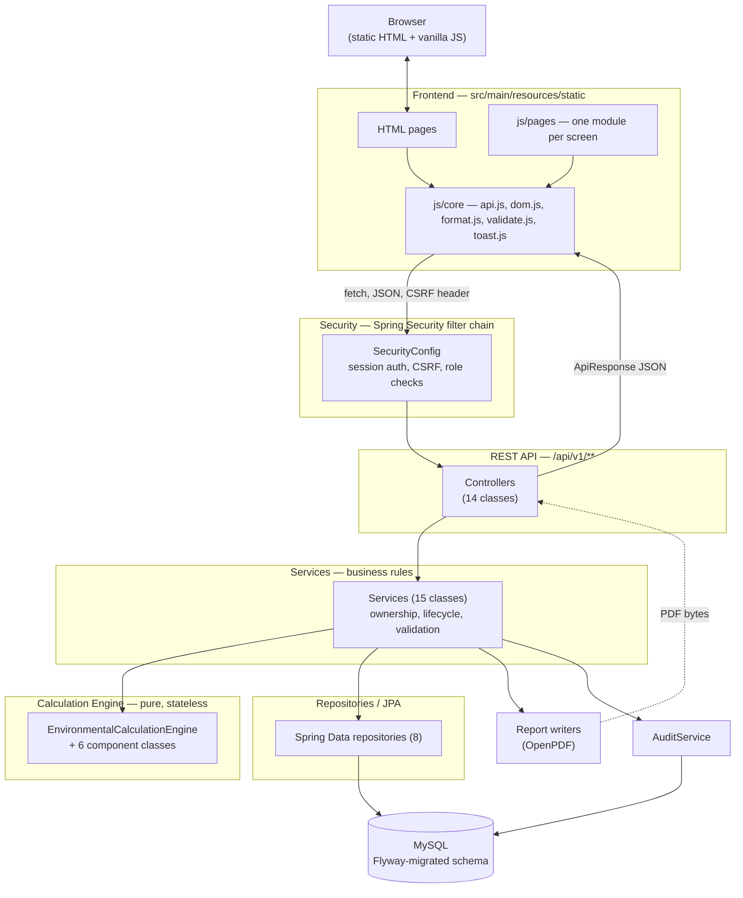
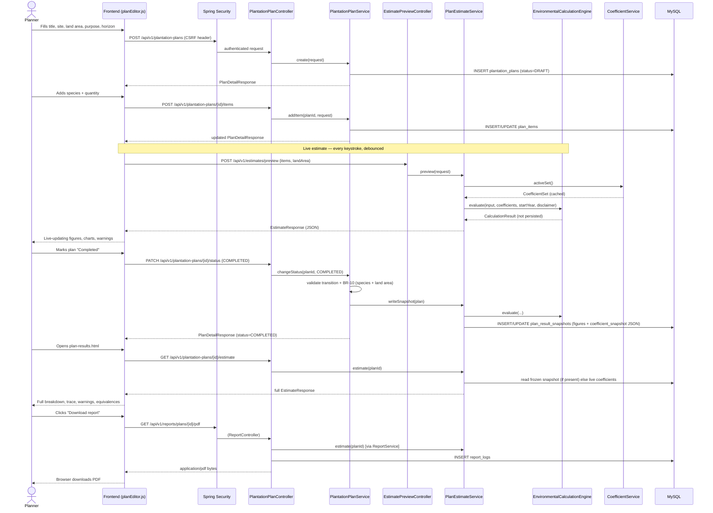
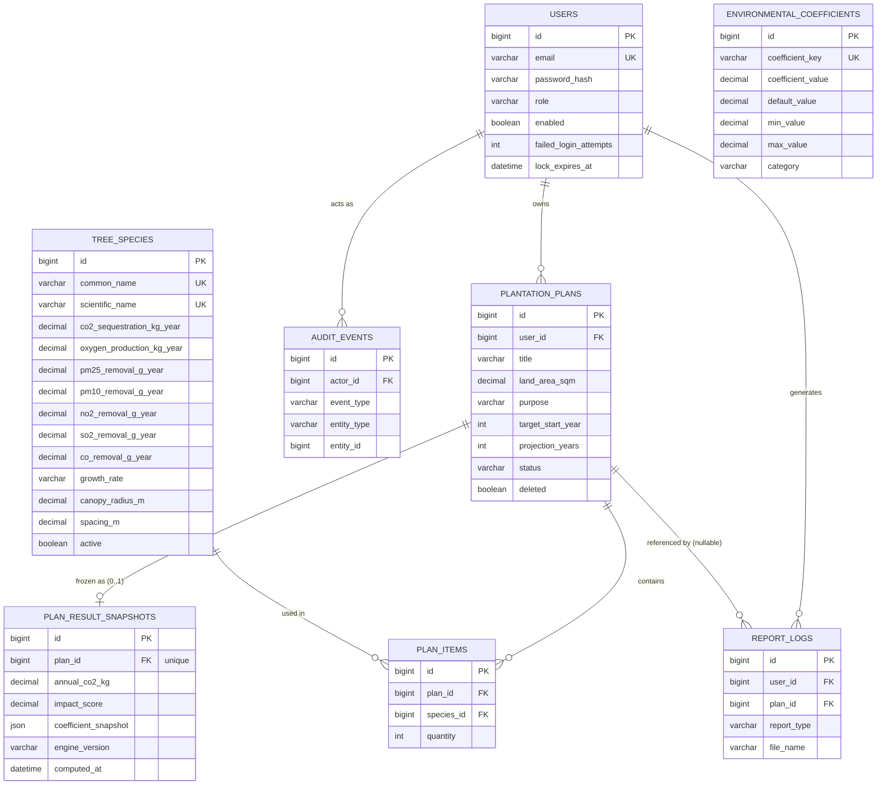
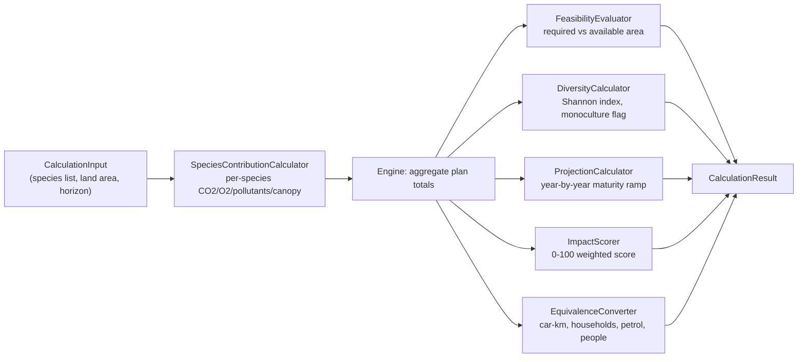
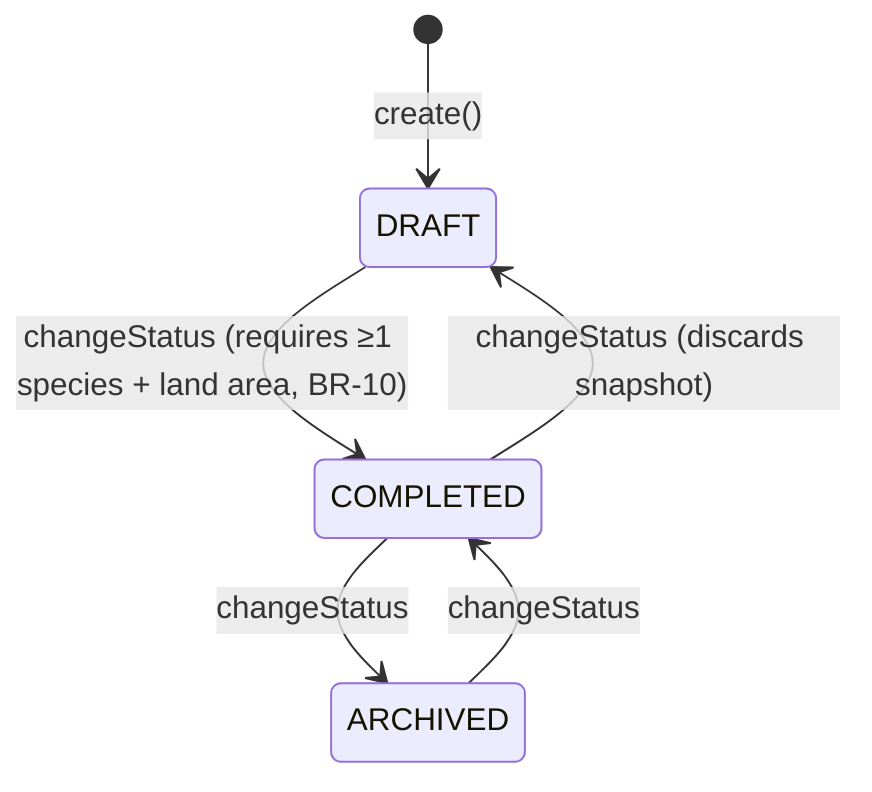
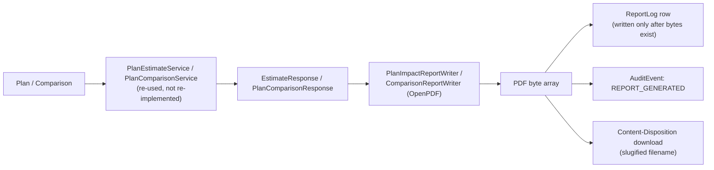

# UrbanCanopy — System Guide

**The primary system-understanding document.** Read this before touching the code. It is
written so a new teammate can go from "what is this?" to "where do I change it?" without
needing anyone to explain the architecture in person.

> **How this document was produced.** Every claim below was checked against the actual
> source in this repository — the Java classes, the Flyway migrations, the frontend
> JavaScript, `pom.xml`, and the test suite — not against a spec or a plan. Where the
> repository also contains `docs/07-complete-knowledge-base.md` (a local, gitignored
> working-notes file, see `.gitignore`), that file was used as a drafting aid but every
> fact here has been re-verified against code. Anything that could not be verified says so
> explicitly. If this document and the code ever disagree, **the code is right** — please
> fix this file in the same change that changes the behaviour.

---

## Table of contents

1. [Project at a glance](#1-project-at-a-glance)
2. [System boundary](#2-system-boundary)
3. [User roles](#3-user-roles)
4. [Complete feature map](#4-complete-feature-map)
5. [System architecture](#5-system-architecture)
6. [Repository map](#6-repository-map)
7. [End-to-end system flow](#7-end-to-end-system-flow)
8. [Major user flows](#8-major-user-flows)
9. [Screen-by-screen guide](#9-screen-by-screen-guide)
10. [Database model](#10-database-model)
11. [Data flow](#11-data-flow)
12. [Environmental calculation engine](#12-environmental-calculation-engine)
13. [Calculation example](#13-calculation-example)
14. [Environmental data and provenance](#14-environmental-data-and-provenance)
15. [Result snapshots and reproducibility](#15-result-snapshots-and-reproducibility)
16. [Plan lifecycle](#16-plan-lifecycle)
17. [REST API map](#17-rest-api-map)
18. [Backend code map](#18-backend-code-map)
19. [Frontend code map](#19-frontend-code-map)
20. [Security architecture](#20-security-architecture)
21. [Report system](#21-report-system)
22. [Failure and error flows](#22-failure-and-error-flows)
23. [Testing](#23-testing)
24. [Configuration and running the project](#24-configuration-and-running-the-project)
25. [Common development tasks](#25-common-development-tasks)
26. [Debugging guide](#26-debugging-guide)
27. [Design decisions](#27-design-decisions)
28. [Limitations](#28-limitations)
29. [Future extensions](#29-future-extensions)
30. [Teammate onboarding checklist](#30-teammate-onboarding-checklist)
31. [Creator / developer cheat sheet](#31-creator--developer-cheat-sheet)
32. [Viva / presentation reference](#32-viva--presentation-reference)

---

## 1. PROJECT AT A GLANCE

| | |
|---|---|
| **Name** | UrbanCanopy |
| **Full title** | Urban Tree Plantation Plan to Estimate Annual Carbon Sequestration and Improve Air Quality |
| **Version** | 1.0.0 (`pom.xml`, `app.version` in `application.yml`) |
| **One-line description** | A Spring Boot web application that turns a planned urban tree planting into a defensible, reproducible estimate of its environmental benefit — carbon, oxygen, air-quality improvement, canopy coverage and species diversity. |
| **Problem** | A municipal planner or institution deciding on an urban plantation has no quick way to know, before planting, what a given mix of species on a given site will actually deliver — how much carbon it will sequester, whether the site can physically hold that many trees, and whether the mix is ecologically risky (monoculture). |
| **Solution** | A calculation engine that converts a species list, quantities and a land area into carbon/oxygen/pollutant figures, a spatial feasibility verdict, a diversity score, a multi-year projection and a single impact score — all derived from literature-sourced, admin-editable coefficients, never hardcoded constants. |
| **Target users** | Municipal urban-greening planners, institutional campus planners, and administrators who curate the species catalogue and the scientific constants. |
| **Scope** | Single-tenant web application; planning and estimation only — not a GIS system, not a live sensor/monitoring system, not a nursery/procurement system. |

### Technology stack (verified from `pom.xml` and config)

| Layer | Technology |
|---|---|
| Language / runtime | Java 21 |
| Framework | Spring Boot 3.5.16 (`spring-boot-starter-parent`) |
| Web | Spring MVC (`spring-boot-starter-web`) |
| Persistence | Spring Data JPA / Hibernate, `ddl-auto: validate` |
| Database | MySQL (`mysql-connector-j`), default `jdbc:mysql://localhost:3306/urban_canopy` |
| Migrations | Flyway (`flyway-core`, `flyway-mysql`) — 3 versioned SQL migrations |
| Security | Spring Security (form login, session-based, BCrypt, CSRF) |
| Validation | Jakarta Bean Validation (`spring-boot-starter-validation`) |
| PDF generation | OpenPDF |
| Test DB (repository tests) | H2, in-memory |
| Testing | JUnit 5 + `spring-security-test` |
| Frontend | Static HTML + vanilla JavaScript (ES modules) — no SPA framework, no build step |
| Charts | Chart.js (`chart.umd.min.js`, vendored) |
| CSS framework | Bootstrap 5 (`bootstrap.bundle.min.js`, vendored) plus custom CSS |
| Build | Maven (`pom.xml`), wrapper under `.m2` |

### 30-Second Explanation

UrbanCanopy is a web app where a planner lists which tree species they want to plant, in
what quantities, on how much land. The app instantly estimates the carbon it will absorb,
the air pollution it will remove, whether the trees will physically fit, and how
ecologically risky the species mix is — using scientific reference values an administrator
can inspect and tune, never a black box.

### 2-Minute Explanation

A planner registers, creates a **plantation plan** (a title, a site, a land area, a target
year, a projection horizon and a purpose), and adds tree species with quantities from a
25-species reference catalogue. As they type, the app calls a **live preview** endpoint and
shows the estimate updating in real time — carbon and oxygen per year, five tracked
pollutants, canopy area and coverage, a feasibility verdict (does this fit the land?), a
species-diversity score, a 0–100 impact score, and a year-by-year projection to maturity.

The estimate is never a raw multiplication of "quantity × rate". Every species contribution
is adjusted for expected **survival**, a **site-condition factor**, and a **maturity ramp**
(a tree does not sequester at full rate the year it is planted). All of these adjustment
constants, plus every threshold and equivalence factor, live in a database table an
administrator can edit — the code never hardcodes a scientific constant.

When the planner is satisfied, they mark the plan **Completed**. That freezes a **result
snapshot** — the computed figures *and* the exact coefficient values used — so an
administrator revising the survival rate next year does not silently rewrite a report
already handed to a stakeholder. From a completed (or draft) plan, the planner can generate
a PDF impact report, or compare two to four plans side by side. Administrators additionally
curate the species catalogue, tune coefficients, and review an audit trail of security and
reference-data events.

### Technical Explanation

Spring Boot MVC application, package-by-feature (`user`, `species`, `plan`, `coefficient`,
`dashboard`, `report`, `audit`, `calculation`, `common`, `config`). Session-based Spring
Security authentication (BCrypt passwords, CSRF via cookie, role-based authorisation:
`ROLE_USER` / `ROLE_ADMIN`). Flyway-managed MySQL schema (3 migrations: baseline schema,
seed data, a UTC-timestamp correction). A pure, side-effect-free calculation engine
(`EnvironmentalCalculationEngine` and its six `component` classes) takes a `CalculationInput`
and a `CoefficientSet` and returns an immutable `CalculationResult` — no database, no Spring,
no HTTP — which is what makes it unit-testable with plain JUnit and reusable for both live
preview and persisted plans. The frontend is static HTML with vanilla JS modules talking to
a JSON REST API under `/api/v1/**`; there is no SPA framework and no bundler.

---

## 2. SYSTEM BOUNDARY

### What UrbanCanopy DOES

- Lets a registered user compose a **plantation plan**: site, land area, purpose, start
  year, projection horizon, and a list of (species, quantity) items.
- Computes, from that composition and a set of editable coefficients: effective
  (survival-and-site-adjusted) tree count, annual CO₂/O₂, five pollutants (PM2.5, PM10, NO₂,
  SO₂, CO), canopy area and coverage, a spatial feasibility verdict, a Shannon-diversity
  index and monoculture warning, a 0–100 impact score, real-world equivalences (car-km,
  households, petrol litres, people's oxygen need), and a year-by-year projection.
- Freezes a plan's result as an immutable **snapshot** when the plan is marked Completed, so
  historical figures never silently change when coefficients are later revised.
- Compares 2–4 plans side by side.
- Generates downloadable PDF reports (single-plan impact report, multi-plan comparison
  report) and logs every generation.
- Lets an administrator curate the tree-species catalogue, tune the environmental
  coefficients (within declared min/max ranges, with a restore-to-default action), manage
  user accounts (enable/disable, role), and review an audit trail and the report-generation
  log.
- Enforces authentication, authorisation (ownership + role), CSRF protection, and
  account lockout after repeated failed logins.

### What UrbanCanopy DOES NOT do

- **Not** a GIS or mapping tool — land area is a single numeric figure the planner types in
  (with a unit), not a drawn polygon or geocoded site.
- **Not** a live environmental sensor or monitoring platform — all pollutant/carbon figures
  are literature-derived *estimates* per species, not measurements of any real planting.
- **Not** a certified carbon-accounting or carbon-credit instrument — the disclaimer
  returned with every calculation states this explicitly (`ApplicationProperties.disclaimer`).
- **Not** a nursery, procurement, or planting-logistics system — it does not track physical
  sourcing, delivery, or on-ground planting/maintenance activity.
- **Not** multi-tenant in the SaaS sense — there is one shared species catalogue and one
  shared coefficient registry; plans are scoped per user, not per organisation.
- **Not** a predictive/ML model — every figure is a deterministic multiplication chain over
  admin-editable constants (`EnvironmentalCalculationEngine` — "not a model, not a predictor").

### Inputs, processing, outputs

| | |
|---|---|
| **Inputs** | Registration details; a plan's title/site/purpose/land area/start year/horizon; a list of (tree species, quantity); administrator edits to species records and coefficient values. |
| **Processing** | Deterministic BigDecimal arithmetic in `EnvironmentalCalculationEngine` and its components; no floating point in any reported figure except the Shannon index (documented, justified exception — §12). |
| **Outputs** | JSON estimate payloads consumed by the frontend; PDF reports (OpenPDF); dashboard aggregates and chart data; an audit trail and a report log. |
| **External dependencies** | None at runtime beyond the MySQL database — no third-party APIs, no external ML services, no payment or messaging integrations. |
| **Data sources** | Seeded species and coefficient data compiled from published urban-forestry literature (Nowak & Crane 2002, i-Tree Eco v6 / USDA Forest Service, ICFRE, Forest Survey of India, CPCB guidelines — each row's `source_citation`/`source` column names its own source). |
| **Environmental assumptions** | Linear (not sigmoid) maturity ramp; canopy footprint uses planted (not survival-adjusted) count; a fixed default `site.condition.factor` of 1.0; five pollutants tracked (not the full set a real air-quality model might use). See §12 and §28 for the full list. |
| **Deliberate limitations** | Single land-area figure (no polygon/soil-layer input); one shared, not versioned-per-region, coefficient set; PDF-only report format. |

---

## 3. USER ROLES

Two roles exist, stored as a single column (`users.role`), not a join table — see
`Role.java`: *"the role set is closed and fixed, a user holds exactly one, and ROLE_ADMIN
subsumes ROLE_USER."*

### ROLE_USER — Planner

- **Purpose:** create and manage their own plantation plans.
- **Accessible pages:** `index.html`, `login.html`, `register.html`, `species.html`,
  `plans.html`, `plan-editor.html`, `plan-results.html`, `compare.html`, `profile.html`,
  `dashboard.html`.
- **Allowed:** register, sign in/out, browse the species catalogue, create/edit/duplicate/
  delete (soft) their own plans, add/update/remove items on their own plans, change their
  own plan's status, preview an unsaved estimate, view their own dashboard, generate reports
  for plans they own, compare their own plans, edit their own profile/password.
- **Forbidden:** viewing or editing another planner's plan; any `/api/v1/admin/**` endpoint;
  changing coefficients, species catalogue, or other users' accounts.

### ROLE_ADMIN — Administrator

Implies everything `ROLE_USER` can do, plus:

- **Accessible pages (additional):** `admin/species.html`, `admin/coefficients.html`,
  `admin/users.html`, `admin/audit.html`, `admin/report-logs.html`.
- **Allowed:** create/update/deactivate/delete tree species and upload species images;
  view/update/restore-to-default environmental coefficients; list/enable/disable users and
  change their role; **read** (never write) any user's plan, for support — every such read
  is written to the audit trail as `ADMIN_VIEWED_PLAN`; view every plan across all users
  (`AdminPlanController`); view the audit-event log and the report-generation log.
- **Forbidden — by design, not oversight:** an administrator **cannot** modify or delete
  another user's plan. `PlanAccessService.requireOwned()` refuses this "including when the
  caller is an administrator" (source comment, verified in code). Support access is
  read-only and always audited.

### Permissions matrix

| Capability | Planner | Administrator |
|---|:---:|:---:|
| Register / sign in / sign out | ✅ | ✅ |
| Browse species catalogue (read) | ✅ (public, unauthenticated GET too) | ✅ |
| Create / edit / delete own plans | ✅ | ✅ (own plans only) |
| Read another user's plan | ❌ | ✅ (audited) |
| Write to another user's plan | ❌ | ❌ |
| Preview unsaved estimate | ✅ | ✅ |
| Generate reports for own plans | ✅ | ✅ |
| Compare own plans | ✅ | ✅ |
| View own dashboard | ✅ | ✅ (+ system-wide admin KPIs) |
| Manage tree species (create/update/deactivate/delete/image) | ❌ | ✅ |
| Manage environmental coefficients | ❌ | ✅ |
| Manage user accounts (enable/disable/role) | ❌ | ✅ |
| View audit-event log | ❌ | ✅ |
| View report-generation log | ❌ | ✅ |
| View all plans (list, read-only) | ❌ | ✅ |

---

## 4. COMPLETE FEATURE MAP

| Feature | User | Frontend | API | Backend | Database | Output |
|---|---|---|---|---|---|---|
| Registration | Planner | `register.html`, `pages/register.js` | `POST /api/v1/auth/register` | `AuthController` → `RegistrationService` | `users` | New account, `ACCOUNT_REGISTERED` audit event |
| Sign in / out | Both | `login.html`, `pages/login.js` | `POST /api/v1/auth/login`, `POST /api/v1/auth/logout` | Spring Security form login + `AuthController` | `users` (lockout counters) | Session cookie; `LOGIN_SUCCEEDED`/`LOGIN_FAILED` audit events |
| Password change | Both | `profile.html` | `POST /api/v1/auth/password` | `AuthController` | `users` | `PASSWORD_CHANGED` audit event |
| Profile view/edit | Both | `profile.html`, `pages/profile.js` | `GET/PUT /api/v1/profile` | `ProfileController` → `UserService` | `users` | Updated profile |
| Species catalogue (browse) | Both, public GET | `species.html`, `pages/species.js` | `GET /api/v1/tree-species`, `/{id}`, `/options`, `/filters` | `TreeSpeciesController` | `tree_species` | Paginated catalogue, filter options |
| Species curation | Admin | `admin/species.html` | `GET/POST/PUT/PATCH/DELETE /api/v1/admin/tree-species/**` | `AdminTreeSpeciesController` → `TreeSpeciesService` | `tree_species` | Created/updated/deactivated species; `SPECIES_*` audit events |
| Species image upload | Admin | `admin/species.html` | `POST /api/v1/admin/tree-species/{id}/image` | `AdminTreeSpeciesController` → `SpeciesImageService`/`SpeciesImageStorageService` | `tree_species.image_path` | Stored file under `uploads/species` |
| Plan creation/editing | Planner | `plan-editor.html`, `pages/planEditor.js` | `POST/PUT /api/v1/plantation-plans`, `/{id}` | `PlantationPlanController` → `PlantationPlanService` | `plantation_plans` | Created/updated plan |
| Plan item management | Planner | `plan-editor.html` | `POST/PUT/DELETE /api/v1/plantation-plans/{id}/items[/{itemId}]` | `PlantationPlanController` → `PlantationPlanService` | `plan_items` | Composition change |
| Live estimate (preview) | Planner | `plan-editor.html` (debounced) | `POST /api/v1/estimates/preview` | `EstimatePreviewController` → `PlanEstimateService.preview` | none (stateless) | Estimate JSON, not persisted |
| Plan lifecycle (status) | Planner | `plan-editor.html`, `plans.html` | `PATCH /api/v1/plantation-plans/{id}/status` | `PlantationPlanController` → `PlantationPlanService.changeStatus` | `plantation_plans.status`, `plan_result_snapshots` | Status change; snapshot written/discarded |
| Plan duplication | Planner | `plans.html` | `POST /api/v1/plantation-plans/{id}/duplicate` | `PlantationPlanController` | `plantation_plans`, `plan_items` | New draft copy |
| Plan deletion (soft) | Planner | `plans.html` | `DELETE /api/v1/plantation-plans/{id}` | `PlantationPlanController` | `plantation_plans.deleted` | Plan hidden from listings |
| View results | Planner/Admin (read) | `plan-results.html`, `pages/planResults.js` | `GET /api/v1/plantation-plans/{id}/estimate` | `PlantationPlanController` → `PlanEstimateService.estimate` | `plan_result_snapshots` (if completed) | Full breakdown, trace, warnings |
| Plan comparison | Planner | `compare.html`, `pages/compare.js` | `GET /api/v1/comparisons?planIds=` | `PlanComparisonController` → `PlanComparisonService` | reads plans + live coefficients | Side-by-side comparison, best-performer flags |
| Dashboard | Both | `dashboard.html`, `pages/dashboard.js` | `GET /api/v1/dashboard/summary`, `/charts/{key}` | `DashboardController` → `DashboardService` | reads plans, live coefficients | KPI cards, 4 charts |
| PDF plan report | Planner/Admin | `plan-results.html` (download) | `GET /api/v1/reports/plans/{planId}/pdf` | `ReportController` → `ReportService` → `PlanImpactReportWriter` | `report_logs` | Downloaded PDF |
| PDF comparison report | Planner | `compare.html` (download) | `GET /api/v1/reports/comparison/pdf` | `ReportController` → `ReportService` → `ComparisonReportWriter` | `report_logs` | Downloaded PDF |
| Report log | Admin | `admin/report-logs.html` | `GET /api/v1/admin/report-logs`, `/types` | `AdminReportLogController` → `ReportService` | `report_logs` | Paginated log |
| Coefficient registry | Admin | `admin/coefficients.html` | `GET/PUT /api/v1/admin/coefficients`, `/{id}`, `/{id}/restore-default` | `AdminCoefficientController` → `CoefficientAdminService` → `CoefficientService` | `environmental_coefficients` | Updated constant; `COEFFICIENT_CHANGED`/`COEFFICIENT_RESTORED` audit events |
| User administration | Admin | `admin/users.html` | `GET /api/v1/admin/users`, `/roles`, `/{id}`, `PATCH .../status`, `.../role` | `AdminUserController` → `UserService` | `users` | Enabled/disabled account, changed role; audit events |
| Audit trail | Admin | `admin/audit.html` | `GET /api/v1/admin/audit-events`, `/types` | `AdminAuditController` → `AuditService` | `audit_events` | Paginated security/reference-data trail |
| Search/filter/pagination | Both | most list screens | query params on list `GET` endpoints | Spring Data `Pageable` + repository `search*` methods | indexed columns | `PageResponse<T>` envelope |
| Validation | Both | client mirror in `core/validate.js` | every write endpoint | Bean Validation on DTOs + service-layer business rules + DB `CHECK` constraints | `CHECK` constraints | `400`/`422` with field errors |
| Error handling | Both | `core/toast.js`, page error states | every endpoint | `GlobalExceptionHandler` | — | Uniform `ErrorResponse` JSON envelope |

Species diversity, impact score, carbon/oxygen/PM2.5/PM10/NO₂/SO₂/CO, canopy, spatial
feasibility, multi-year projection, equivalences, calculation trace and scientific
provenance are **not separate features** in the code — they are all fields of the single
`CalculationResult` produced by `EnvironmentalCalculationEngine.evaluate()` and are covered
in depth in §12–§13.

---

## 5. SYSTEM ARCHITECTURE



### Layer responsibilities

| Layer | Responsible for | Must NOT contain |
|---|---|---|
| **Frontend (static HTML + JS)** | Rendering, client-side validation mirror, calling the API, showing toasts/errors. | Business rules that the server does not also enforce; any scientific constant. |
| **Controllers** | HTTP mapping, request/response DTO shape, delegating to exactly one service call per use case. | Business logic, direct repository access, calculation logic. |
| **Services** | Ownership/authorisation checks, lifecycle rules, orchestration, transactions. | HTTP concerns (status codes, headers); direct SQL. |
| **Calculation engine** (`calculation` package) | Pure arithmetic: turning inputs + coefficients into results. | Database access, Spring annotations beyond `@Service`/`@Component`, HTTP, mutation of its inputs. |
| **Repositories** | Query construction (Spring Data + a few `@Query`s), fetch-join strategy. | Business rules, DTO mapping. |
| **Entities** | Invariants that hold for *every* caller (e.g. `PlantationPlan.addSpecies` incrementing rather than duplicating). | Authorisation, HTTP, cross-entity business rules that depend on caller identity. |
| **Config** (`SecurityConfig`, `WebMvcConfig`, `JacksonConfig`, `JpaAuditingConfig`, `ApplicationProperties`) | Cross-cutting policy: security filter chain, JSON shape, auditing fields, typed config binding. | Feature-specific logic. |
| **Report writers** (`report/pdf`) | Rendering an already-authorised result into PDF bytes. | Re-deriving authorisation or re-running calculations independently of the service layer. |
| **Audit** (`AuditService`) | Recording security decisions and reference-data changes. | Ordinary user activity (deliberately not logged — see §20). |

---

## 6. REPOSITORY MAP

```
PROJECT/
├── pom.xml                      Maven build, dependencies, Java 21
├── README.md                    Public-facing project description
├── docs/                        Documentation (this file + companion docs 01–07)
│   └── screenshots/
├── src/main/java/com/urbancanopy/
│   ├── audit/                   Audit-event logging (controller, service, repository, entity)
│   ├── calculation/             Pure calculation engine (see §12)
│   ├── coefficient/              Environmental coefficient registry (admin-tunable constants)
│   ├── common/                  Cross-cutting: domain base classes, DTOs, exceptions, security helpers, util
│   ├── config/                  Spring configuration classes
│   ├── dashboard/                Dashboard aggregation and charts
│   ├── plan/                     Plantation plans: entity, lifecycle, items, comparison, estimate
│   ├── report/                   PDF generation and report logging
│   ├── species/                  Tree species catalogue
│   └── user/                     Accounts, registration, profile, roles
├── src/main/resources/
│   ├── application.yml, application-dev.yml, application-prod.yml
│   ├── db/migration/             Flyway SQL migrations (V1–V3)
│   └── static/                   Frontend: HTML pages, css/, js/
├── src/test/java/com/urbancanopy/
│   ├── calculation/               Engine tests + fixtures
│   ├── plan/                      Entity, repository, service tests
│   ├── report/pdf/                PDF writer tests
│   ├── support/                   Shared entity fixtures
│   └── web/                       Security boundary tests
├── uploads/                       Runtime species image storage (gitignored)
└── target/                        Maven build output (gitignored)
```

### "Where do I go if I need to change X?"

| Task | Look here |
|---|---|
| Change a calculation/formula | `calculation/component/*.java` (one class per concern), orchestrated by `calculation/EnvironmentalCalculationEngine.java` |
| Add a tree species | `V2__seed_reference_data.sql` for seed data, or `AdminTreeSpeciesController`/`TreeSpeciesService` at runtime (admin UI: `admin/species.html`) |
| Add an environmental coefficient | New row in `environmental_coefficients` (via a migration or the admin UI) + a constant key in `CoefficientKeys.java` + use it in the relevant `calculation/component` class |
| Add a new environmental metric (e.g. a 6th pollutant) | `tree_species` table + entity/DTO field, `SpeciesContributionCalculator`, `CalculationResult`, the snapshot table/entity, the PDF writers, the frontend chart/results page |
| Add/modify an API endpoint | The relevant `*Controller.java`, its DTO(s) in `*/dto/`, the service method it calls |
| Change dashboard data | `dashboard/service/DashboardService.java` (aggregation), `dashboard/dto/*` |
| Change a PDF report | `report/pdf/PlanImpactReportWriter.java` or `ComparisonReportWriter.java`, shared building blocks in `PdfBlocks.java`/`PdfTheme.java`/`ReportFormatter.java` |
| Change authentication/authorisation | `config/SecurityConfig.java` (filter chain, rules), `common/security/*` (current-user resolution), `@PreAuthorize`/role checks in controllers |
| Change plan validation | Bean Validation annotations on `plan/dto/*Request.java`; business rules in `plan/service/PlantationPlanService.java`; DB `CHECK` constraints in `V1__baseline_schema.sql` |
| Change frontend styling | `static/css/` |
| Add a new screen | New `static/<name>.html` + `static/js/pages/<name>.js`, wired to `static/js/core/api.js`; add the route to `SecurityConfig`'s `permitAll()` matcher if it's a new public page pattern |
| Fix a database issue | `db/migration/` for schema; corresponding entity in `*/entity/`; `application.yml` for connection settings |

---

## 7. END-TO-END SYSTEM FLOW

The canonical lifecycle — composing a plan through to a downloaded report:



For every step: the **user action** is on the left of the arrow above; the **frontend
module** is named in the box; the **API endpoint**, **controller**, **service**, and
**database table** are named on each arrow/participant; the **response** and **UI result**
are the final arrows back to the user. See §17 for the full endpoint catalogue and §12–§13
for what happens inside `Eng.evaluate(...)`.

---

## 8. MAJOR USER FLOWS

Each flow: **USER → FRONTEND → API → BACKEND → DATABASE → RESPONSE.**

### Authentication

```mermaid
sequenceDiagram
    actor U as User
    participant FE as login.js / api.js
    participant Sec as Spring Security<br/>(form-login filter)
    participant UDS as UrbanCanopyUserDetailsService
    participant LAH as LoginAttemptHandler
    participant DB as MySQL (users)

    U->>FE: Submits email + password
    FE->>Sec: POST /api/v1/auth/login (form-encoded, CSRF header)
    Sec->>UDS: loadUserByUsername(email)
    UDS->>DB: SELECT * FROM users WHERE email = ?
    DB-->>UDS: User row (or none)
    Sec->>Sec: BCryptPasswordEncoder.matches(password, hash)
    alt credentials valid and account not locked/disabled
        Sec->>LAH: onSuccess()
        LAH->>DB: reset failed_login_attempts; update last_login_at
        Sec->>Sec: changeSessionId() (fixation protection)
        Sec-->>FE: 200 + session cookie
        Sec->>DB: INSERT audit_events (LOGIN_SUCCEEDED)
        FE-->>U: Redirected into the app shell
    else invalid credentials, locked, or disabled
        Sec->>LAH: onLoginFailure()
        LAH->>DB: increment failed_login_attempts; set lock_expires_at if threshold reached
        Sec-->>FE: 401 ErrorResponse (JSON, never a redirect)
        Sec->>DB: INSERT audit_events (LOGIN_FAILED)
        FE-->>U: Toast: "Invalid email address or password." (or lockout message)
    end
```

USER submits email/password on `login.html` → `pages/login.js` calls `api.login()`
(`core/api.js`, form-encoded POST) → `POST /api/v1/auth/login` is consumed by **Spring
Security's form-login filter**, not a controller method — it reads `email`/`password`
request parameters (configured in `SecurityConfig.formLogin()`) → `UrbanCanopyUserDetailsService`
loads the `User` by email, `BCryptPasswordEncoder` verifies the hash, `LoginAttemptHandler`
records success/failure and applies lockout after `app.security.max-failed-attempts` (5)
failures for `app.security.lock-minutes` (15) → on success a new session is created
(session-fixation protection: `changeSessionId()`) and `LOGIN_SUCCEEDED` is audited; on
failure `LOGIN_FAILED` is audited and a JSON `ErrorResponse` (never a redirect) is returned
→ frontend shows a toast or navigates to the app shell.

### Create Plantation Plan

USER fills the plan form on `plan-editor.html` → `pages/planEditor.js` validates client-side
(`core/validate.js`) and calls `api.post('/plantation-plans', body)` → `POST
/api/v1/plantation-plans` → `PlantationPlanController.create()` → `PlantationPlanService.create()`
enforces per-owner title uniqueness and the projection-horizon limit → `INSERT
plantation_plans` (status `DRAFT`) → `PlanDetailResponse` returned → editor shows the new
plan, empty of species.

### Edit Plantation Plan

USER changes the header or adds/removes species → `PUT /api/v1/plantation-plans/{id}` or
`POST/PUT/DELETE .../items[/{itemId}]` → `PlantationPlanController` → `PlantationPlanService`
calls `PlanAccessService.requireEditable()` (owner-only, and refused if the plan is
`ARCHIVED`) → entity mutation (`PlantationPlan.addSpecies` increments an existing row rather
than duplicating, enforcing BR-08 at the entity level) → `plan_items`/`plantation_plans`
updated → updated `PlanDetailResponse` → editor re-renders and re-triggers the live
preview.

### Calculate Results (live preview)

USER edits species/quantity/land area in the editor → `pages/planEditor.js` debounces and
calls `POST /api/v1/estimates/preview` with the *unsaved* composition →
`EstimatePreviewController.preview()` → `PlanEstimateService.preview()` resolves species by
id (rejecting unknown/inactive/duplicate ids), loads the **live** `CoefficientSet` →
`EnvironmentalCalculationEngine.evaluate()` (no database write) → `EstimateResponse` JSON →
frontend updates figures/charts/warnings live, nothing persisted.

### View Results

USER opens `plan-results.html` for a saved plan → `GET
/api/v1/plantation-plans/{id}/estimate` → `PlantationPlanController` → `PlanEstimateService.estimate()`
→ `PlanAccessService.requireReadable()` (owner or admin; admin read is audited) → if a
snapshot exists (`COMPLETED` plan), its **frozen** coefficients are read back from
`plan_result_snapshots.coefficient_snapshot` (JSON) and re-evaluated against them; otherwise
the **live** registry is used → full `EstimateResponse` including the calculation trace →
results page renders every metric, the trace, warnings and equivalences.

### Compare Plans

USER selects 2–4 of their own plans on `compare.html` → `GET
/api/v1/comparisons?planIds=1,2,3` → `PlanComparisonController` → `PlanComparisonService.compare()`
validates the count is within `[app.plan.min-plans-per-comparison,
max-plans-per-comparison]` (2–4) and that every id belongs to the caller → evaluates each
plan against the **live** coefficient registry (so the comparison is apples-to-apples, even
if one plan's own results screen shows a frozen figure) → `PlanComparisonResponse` with
per-metric best-performer flags → comparison table + chart rendered.

### Generate Report

USER clicks "Download report" on `plan-results.html` or `compare.html` → `GET
/api/v1/reports/plans/{planId}/pdf` or `GET /api/v1/reports/comparison/pdf?planIds=...` →
`ReportController` → `ReportService` re-uses `PlanEstimateService`/`PlanComparisonService`
(so authorisation is never re-implemented) → `PlanImpactReportWriter`/`ComparisonReportWriter`
(OpenPDF) render the PDF bytes → `INSERT report_logs` (only after the bytes exist) and an
`AuditService.record(REPORT_GENERATED, ...)` entry → PDF bytes streamed back with a safe,
slugified `Content-Disposition` filename → browser downloads the file.

### Admin Species Management

ADMIN opens `admin/species.html` → CRUD calls to `/api/v1/admin/tree-species/**` →
`AdminTreeSpeciesController` → `TreeSpeciesService` validates uniqueness (common/scientific
name), positivity constraints mirrored from the DB `CHECK`s → `tree_species` row
inserted/updated; deactivation sets `active=false` rather than deleting (species already
used in a plan must remain resolvable) → `SPECIES_*` audit event → admin UI refreshes the
catalogue table.

### Admin Coefficient Management

ADMIN opens `admin/coefficients.html` → `PUT /api/v1/admin/coefficients/{id}` with a new
value → `AdminCoefficientController` → `CoefficientAdminService` → `CoefficientService.updateValue()` checks the value
is within the coefficient's own `min_value`/`max_value`, and if it is one of the four
scoring weights, that all four still sum to 1.0 (BR-20) → `environmental_coefficients` row
updated, the in-memory `AtomicReference<CoefficientSet>` cache is invalidated →
`COEFFICIENT_CHANGED` audited → next calculation (anywhere in the app) picks up the new
value immediately, with no restart.

### Audit / Report Log

ADMIN opens `admin/audit.html` or `admin/report-logs.html` → `GET
/api/v1/admin/audit-events` / `GET /api/v1/admin/report-logs` → `AdminAuditController`/
`AdminReportLogController` → `AuditService`/`ReportService` → paginated read of
`audit_events`/`report_logs` → table rendered with filters (event type / report type / user).

---

## 9. SCREEN-BY-SCREEN GUIDE

| Page | Route | Role | Purpose | Key API calls |
|---|---|---|---|---|
| Landing | `index.html` | Public | Marketing/entry point | none (or `/auth/me` probe) |
| Login | `login.html` | Public | Sign in | `POST /auth/login` |
| Register | `register.html` | Public | Create an account | `POST /auth/register` |
| Species catalogue | `species.html` | Public (browse) / Both (authenticated actions) | Browse the 25-species reference catalogue, filter by growth rate/climate/soil/water | `GET /tree-species`, `/filters` |
| My plans | `plans.html` | Planner | List, search, filter, duplicate, delete, change status of own plans | `GET /plantation-plans`, `PATCH .../status`, `POST .../duplicate`, `DELETE` |
| Plan editor | `plan-editor.html` | Planner | Create/edit a plan; add species; see the **live** estimate | `POST/PUT /plantation-plans`, `.../items`, `POST /estimates/preview` |
| Plan results | `plan-results.html` | Planner (own) / Admin (read, audited) | Full breakdown: all metrics, trace, warnings, equivalences, projection chart, PDF download | `GET /plantation-plans/{id}/estimate`, `GET /reports/plans/{id}/pdf` |
| Compare | `compare.html` | Planner | Side-by-side comparison of 2–4 own plans | `GET /comparisons`, `GET /reports/comparison/pdf` |
| Profile | `profile.html` | Both | View/edit own profile, change password | `GET/PUT /profile`, `POST /auth/password` |
| Dashboard | `dashboard.html` | Both | KPI cards + 4 charts over the caller's own plans (+ system-wide KPIs for admins) | `GET /dashboard/summary`, `/dashboard/charts/{key}` |
| Admin: species | `admin/species.html` | Admin | Curate the catalogue | `/admin/tree-species/**` |
| Admin: coefficients | `admin/coefficients.html` | Admin | Tune scientific constants | `/admin/coefficients/**` |
| Admin: users | `admin/users.html` | Admin | Enable/disable accounts, change roles | `/admin/users/**` |
| Admin: audit | `admin/audit.html` | Admin | Security/reference-data trail | `/admin/audit-events` |
| Admin: report logs | `admin/report-logs.html` | Admin | Who generated which document | `/admin/report-logs` |

Every page follows the **four-state contract** (loading / empty / error / loaded) described
in `js/components/states.js`, and every authenticated page's data call goes through
`core/api.js`, which redirects to `login.html?next=<path>` on a 401 rather than showing a
broken page.

---

## 10. DATABASE MODEL

Verified directly from `V1__baseline_schema.sql`. MySQL 8.0.16+, InnoDB, `utf8mb4`.
**No FLOAT/DOUBLE anywhere** — every numeric column is `DECIMAL`, a deliberate choice so a
chain of multiplications never drifts into `12.999999999998`.

### Tables

| Table | Purpose | PK | Notable FKs | ON DELETE |
|---|---|---|---|---|
| `users` | Accounts | `id` | — | — |
| `tree_species` | Scientific reference catalogue | `id` | — | — |
| `environmental_coefficients` | Tunable scientific constants | `id` | — | — |
| `plantation_plans` | A planner's plan | `id` | `user_id → users` | RESTRICT (a user with plans cannot be hard-deleted) |
| `plan_items` | Plan ↔ species association, with quantity | `id` | `plan_id → plantation_plans`, `species_id → tree_species` | CASCADE (plan), RESTRICT (species) |
| `plan_result_snapshots` | Frozen result of a completed plan | `id` | `plan_id → plantation_plans` (unique — one snapshot per plan) | CASCADE |
| `report_logs` | Append-only log of generated PDFs | `id` | `user_id → users`, `plan_id → plantation_plans` (both nullable) | SET NULL |
| `audit_events` | Append-only security/reference-data trail | `id` | `actor_id → users` (nullable) | SET NULL |

### ER diagram



### Key relationships, in plain English

- **`users` 1—N `plantation_plans`**: `ON DELETE RESTRICT` — a user with plans cannot be
  hard-deleted from the database (accounts are disabled, not deleted, for this reason).
- **`plantation_plans` 1—N `plan_items`** (composition, `CASCADE`): delete a plan and its
  items go with it; `uq_plan_item_plan_species` enforces "a species appears at most once
  per plan" (BR-08) at the database level, not just in application code.
- **`tree_species` 1—N `plan_items`** (`RESTRICT`): a species cannot be deleted while any
  plan references it — deactivate (`active=false`) instead, which is exactly what
  `AdminTreeSpeciesController`'s delete-vs-deactivate distinction implements.
- **`plantation_plans` 1—0..1 `plan_result_snapshots`**: `uq_snapshot_plan` makes this a true
  one-to-one-or-none. Written on `COMPLETED`, deleted on reopening to `DRAFT` (§15, §16).
- **`report_logs`/`audit_events`** use `SET NULL` on their user/plan foreign keys — the log
  is designed to outlive the account or plan it refers to; an audit trail that disappears
  when its subject is deleted is not an audit trail.
- **`environmental_coefficients`** has no foreign keys at all — it is pure reference data
  consumed by application code, not joined against.

---

## 11. DATA FLOW

```
User input (HTML form)
  → Request DTO (Bean-Validated, e.g. PlantationPlanRequest, PlanItemRequest)
    → Entity mutation (PlantationPlan, PlanItem — JPA-managed, auditing fields auto-stamped)
      → CalculationInput (calculation/model — a plain, engine-facing projection of the plan)
        → CoefficientSet (calculation/model — either the live registry or a snapshot's frozen map)
          → CalculationResult (calculation/model — the engine's complete, immutable output)
            → EstimateResponse (plan/dto — what the API returns to the frontend)
              → PlanResultSnapshot (plan/entity — persisted ONLY when a plan is COMPLETED)
                → GeneratedReport / PDF bytes (report/pdf — rendered from the EstimateResponse)
```

| Object | What it is |
|---|---|
| Registration/plan/item form fields | User input |
| `User`, `TreeSpecies`, `PlantationPlan`, `PlanItem`, `EnvironmentalCoefficient`, `PlanResultSnapshot`, `ReportLog`, `AuditEvent` | Database entities (`@Entity`) |
| `PlantationPlanRequest`, `PlanItemRequest`, `PreviewEstimateRequest`, `PlanSummary`, `PlanDetailResponse`, `EstimateResponse`, etc. | DTOs — request/response shapes, never entities leaked over the wire |
| `CalculationInput`, `CoefficientSet` | Calculation objects — engine input |
| `CalculationResult` (and its nested records: `Carbon`, `Oxygen`, `Pollutants`, `Canopy`, `Feasibility`, `Diversity`, `ImpactScore`, `SpeciesContribution`, `ProjectionPoint`, `Equivalence`, `TraceEntry`) | Calculation objects — engine output |
| `plan_result_snapshots` row | Persisted result — the only calculation output that is ever stored |
| PDF byte array (`GeneratedReport`) | Report data — rendered, not stored (only its metadata is, in `report_logs`) |

---

## 12. ENVIRONMENTAL CALCULATION ENGINE

**Location:** `src/main/java/com/urbancanopy/calculation/` — `EnvironmentalCalculationEngine`
orchestrates six single-purpose components. The whole engine is a **pure function**: same
`CalculationInput` + `CoefficientSet` in, same `CalculationResult` out, no database, no
Spring context beyond `@Service`/`@Component` for wiring, no HTTP. This is verified directly
from the class Javadoc and confirmed by the fact that `EnvironmentalCalculationEngineTest`
(23 tests) exercises it with plain JUnit and no Spring context.



### Order of operations (from the engine's own Javadoc, verified against `evaluate()`)

1. Evaluate each species independently.
2. Aggregate into plan totals.
3. Derive spatial metrics (canopy, feasibility).
4. Derive composition metrics (diversity).
5. Project year by year across the horizon.
6. Score, convert to equivalences, and record the calculation trace.

### The adjustment every figure passes through — `EffectiveTreeCalculator`

```
effective trees = quantity × survival_rate × site_condition_factor × maturity_factor(year)
```

- `survival_rate` — coefficient `calc.survival.rate`, seeded **0.85**.
- `site_condition_factor` — coefficient `calc.site.condition.factor`, seeded **1.00**
  (range 0.5–1.5).
- `maturity_factor(year)` — **linear ramp** from 0 to 1: `year / yearsToMaturity`, capped at
  1 once `year ≥ yearsToMaturity`. Years-to-maturity is itself a coefficient, keyed by
  growth rate: `calc.maturity.years.slow` = **20**, `.moderate` = **12**, `.fast` = **7**.
  The **headline** annual figure always uses maturity factor = 1 ("at maturity"); the
  **year-by-year projection** uses the real per-year factor.

### Per-species figures — `SpeciesContributionCalculator`

- `CO₂ (kg/yr) = effectiveTrees × co2_sequestration_kg_year`
- `O₂ (kg/yr) = effectiveTrees × oxygen_production_kg_year`
- `PM2.5 / PM10 / NO₂ / SO₂ / CO (g/yr) = effectiveTrees × <pollutant>_removal_g_year`
- `Canopy area (m²) = plantedQuantity × π × canopy_radius_m²` — **uses planted count, not
  effective count**, because "canopy is a physical footprint question... answered by the
  trees that are actually put in the ground" (source comment).
- `Required area (m²) = plantedQuantity × spacing_m²`

### Feasibility — `FeasibilityEvaluator`

```
utilisation % = totalRequiredArea / availableLandArea × 100
```
Verdict from three coefficient thresholds (`feasibility.threshold.*`, seeded 40/90/100):

| Utilisation | Verdict |
|---|---|
| < 40% | `UNDER_UTILISED` |
| ≤ 90% | `OPTIMAL` |
| ≤ 100% | `TIGHT` |
| > 100% | `OVERCROWDED` |
| no land area supplied | `NOT_APPLICABLE` |

`maxPlantableTrees = availableArea / (totalRequiredArea / totalTrees)` — the quantity-weighted
mean footprint of the actual mix, not any single species.

### Diversity — `DiversityCalculator`

Shannon–Wiener index: **H′ = −Σ pᵢ ln pᵢ**, where pᵢ is species *i*'s share of all trees.
This is **the one place the codebase uses `double`** instead of `BigDecimal` — documented
and justified in the source: no natural-log operation exists for `BigDecimal`, the index is
never summed into a reported mass/currency, and `double`'s ~15 significant figures are
"eleven orders of magnitude below what is displayed" (4 decimal places).
Monoculture risk = single species, or the dominant species' share exceeds
`limit.monoculture.share.percent` (seeded **60%**).

### Impact score — `ImpactScorer`

```
overall = carbonSubScore × w_carbon + airSubScore × w_air + canopySubScore × w_canopy + diversitySubScore × w_diversity
```
Each sub-score = `min(100, value/benchmark × 100)`. Carbon and air use **per-tree
intensity** (total ÷ tree count) against a benchmark, deliberately — "scoring absolute
totals would mean the score only ever rewarded planting more trees" (source comment).
Weights (seeded): carbon 0.35, air 0.30, canopy 0.20, diversity 0.15 — **enforced to sum to
1.0** by `CoefficientService` (BR-20) on every edit and at startup.

### Multi-year projection — `ProjectionCalculator`

For each year 1..horizon: `Σ over species of effectiveTreesInYear × co2_kg_per_tree_year`,
accumulated into a running cumulative total; each point also carries the tree-count-weighted
average maturity factor for that year. This is where a fast-growing (7-year) mix and a
slow-growing (20-year) mix with an *identical headline figure* diverge visibly.

### Equivalences — `EquivalenceConverter`

`equivalence = quantity ÷ coefficient` for each of: car-kilometres (`equiv.car.co2.kg.per.km`
= 0.121), households (`equiv.household.electricity.co2.kg.per.year` = 1500), petrol litres
(`equiv.petrol.co2.kg.per.litre` = 2.31), people's annual oxygen need
(`equiv.person.oxygen.kg.per.year` = 262.8). A missing or zero coefficient silently omits
that one equivalence rather than failing the whole calculation.

### Calculation trace

`buildTrace()` returns human-readable `TraceEntry` records with the *actual numbers
substituted* — e.g. `"1000 planted × 0.85 survival × 1 site = 850.00 effective trees; 850.00
× 21.8 kg/tree/yr"` — so any figure can be checked by hand without reading Java. This is
what powers the "how was this calculated?" panel on the results page and the provenance
section of the PDF report.

---

## 13. CALCULATION EXAMPLE

**A single realistic plan: 100 Neem trees, no other species, on 3,000 m² of land, 10-year
projection, starting 2026.** Using the seeded coefficients verified in §12 and the seeded
Neem row (`co2_sequestration_kg_year = 21.800`, `oxygen_production_kg_year = 15.850`,
`pm25 = 54.100 g`, `pm10 = 133.600 g`, `no2 = 79.500 g`, `so2 = 50.900 g`, `co = 35.000 g`,
`canopy_radius_m = 4.50`, `spacing_m = 6.00`, `growth_rate = FAST`).

**1. Effective trees (at maturity):**
`100 × 0.85 (survival) × 1.00 (site) × 1.00 (maturity, headline) = 85.00 effective trees`

**2. Carbon:** `85.00 × 21.800 = 1,853.00 kg CO₂/yr = 1.853 t/yr`

**3. Oxygen:** `85.00 × 15.850 = 1,347.25 kg O₂/yr`

**4. Pollutants (g/yr):**
PM2.5 = `85 × 54.100 = 4,598.50`; PM10 = `85 × 133.600 = 11,356.00`;
NO₂ = `85 × 79.500 = 6,757.50`; SO₂ = `85 × 50.900 = 4,326.50`;
CO = `85 × 35.000 = 2,975.00` → **total = 30,013.50 g/yr = 30.0135 kg/yr**

**5. Canopy (uses planted count, 100, not 85):**
`100 × π × 4.50² = 100 × 3.14159265 × 20.25 = 6,361.73 m²`

**6. Feasibility:**
Required area = `100 × 6.00² = 3,600 m²`. Available = `3,000 m²`.
Utilisation = `3,600 / 3,000 × 100 = 120%` → **`OVERCROWDED`** (> 100% tight threshold).
Max plantable trees = `3,000 / (3,600/100) = 3,000 / 36 = 83`.

**7. Diversity:** single species → **H′ = 0**, monoculture risk = **true** (single species
rule), dominant share = 100%.

**8. Impact score** (benchmarks: 25 kg CO₂/tree, 300 g pollutant/tree, 40% canopy target,
2.5 diversity ceiling):
- Carbon sub-score: per-tree = `1853/100 = 18.53` → `18.53/25 × 100 = 74.12`
- Air sub-score: per-tree = `30013.5/100 = 300.135` → capped at **100**
- Canopy sub-score: coverage = `min(6361.73/3000×100, uncapped) `→ capped at 100% for
  display → `100/40 × 100 =` capped at **100**
- Diversity sub-score: `0/2.5 × 100 = 0`
- Overall = `74.12×0.35 + 100×0.30 + 100×0.20 + 0×0.15 = 25.94 + 30 + 20 + 0 = 75.94`

**9. Equivalences:** CO₂ = 1,853 kg/yr → car-km = `1853/0.121 ≈ 15,314 km`; households =
`1853/1500 ≈ 1` household; petrol = `1853/2.31 ≈ 802` litres. O₂ = 1,347.25 kg/yr → people =
`1347.25/262.8 ≈ 5` people.

**10. Projection (Neem is FAST, 7-year maturity):** year 1 maturity factor = `1/7 = 0.1429`
→ year-1 CO₂ ≈ `85 × 0.1429/1.00 × 21.8` — i.e. the year-1 *effective* tree count uses
maturity 0.1429 instead of 1.0, so year 1 ≈ `100×0.85×1.00×0.1429×21.8 ≈ 264.7 kg`, ramping
linearly until year 7 where it reaches the full 1,853 kg/yr and stays there through year 10.

**Warnings produced:** `OVERCROWDED` (this planting needs more room than is available; at
most 83 trees fit) — no monoculture warning text is separately needed here since the
overcrowding warning takes priority in this example, though the diversity block itself still
reports `monocultureRisk = true`.

*(Figures rounded to the engine's actual scales — 2 dp for effective trees/percentages, 3 dp
for mass figures, 4 dp for the diversity index — per `Decimals` utility scales used
throughout `EnvironmentalCalculationEngine`.)*

---

## 14. ENVIRONMENTAL DATA AND PROVENANCE

- **Tree species data:** 25 species seeded in `V2__seed_reference_data.sql`, each with 7
  environmental rates (CO₂, O₂, 5 pollutants), a full horticultural profile (growth rate,
  water requirement, climate zone, soil type, canopy radius, mature height, life span,
  spacing, native flag), and a **mandatory `source_citation`** column — every row states
  where its numbers came from (Nowak & Crane 2002; i-Tree Eco v6 / USDA Forest Service;
  ICFRE; Forest Survey of India; TERI; CPCB guidelines).
- **Units:** CO₂/O₂ in kg/tree/year; the five pollutants in g/tree/year (an order of
  magnitude smaller, kept legible in grams — column names state their own unit).
- **Environmental coefficients:** 21 rows in `environmental_coefficients`, each carrying a
  current value, a **seeded default** (restorable), a **min/max range** (enforced on every
  edit), a **category** (`ADJUSTMENT`, `FEASIBILITY`, `EQUIVALENCE`, `SCORING`, `LIMIT`), and
  a **source** column. This is the mechanism that makes "never hardcode a scientific
  constant" an enforceable property rather than a coding convention — verified: every
  numeric literal used by the calculation components (survival rate, maturity years, site
  factor, feasibility thresholds, equivalence factors, score weights/benchmarks, monoculture
  threshold) is read via `CoefficientSet`/`CoefficientKeys`, not hardcoded in Java.
- **Editable coefficients:** any of the 21, via `PUT /api/v1/admin/coefficients/{id}`,
  bounded by each row's own `min_value`/`max_value`, with the four `score.weight.*` rows
  additionally constrained to sum to 1.0 (BR-20).
- **Calculation trace:** see §12 — a plain-English, numbers-substituted explanation
  returned with every `EstimateResponse`.
- **Historical reproducibility:** see §15.

---

## 15. RESULT SNAPSHOTS AND REPRODUCIBILITY

**Why they exist:** `plan_result_snapshots` exists, in the schema's own words, "precisely so
that [the figures] do NOT have to be re-derived: without it, an administrator revising
`calc.survival.rate` would silently rewrite every report the system has ever produced."

**When created:** exactly when a plan transitions to `COMPLETED`
(`PlantationPlanService.changeStatus` → `PlanEstimateService.writeSnapshot`). Exactly one
snapshot per plan (`uq_snapshot_plan`); re-completing overwrites the previous one.

**What it contains:** every headline figure (trees, effective trees, CO₂/O₂/pollutants,
canopy, feasibility, diversity, impact score, horizon total) **plus** a `coefficient_snapshot`
JSON column recording the *exact coefficient values in force at that moment*, plus the
`engine_version` string (`app.engine-version`, currently `1.0.0`).

**How it preserves history:** `PlanEstimateService.estimate()` reads the snapshot's frozen
coefficient map (if present) and re-evaluates the engine against **those** values, not the
live registry — so a completed plan's results screen and PDF always match what was true the
moment it was completed, even if an administrator has since changed the survival rate.

**Fallback:** if a snapshot's JSON is unreadable, or predates a coefficient key the current
engine requires, the service logs a warning and falls back to the live registry rather than
throwing — "reporting slightly-too-current figures is a far better failure than a results
screen that throws" (source comment).

**Reopening a completed plan** (`COMPLETED → DRAFT`) **discards** its snapshot
(`PlanEstimateService.discardSnapshot`) — a draft displaying frozen figures that no longer
match its (about-to-change) species list would be worse than showing none. Re-completing
writes a fresh snapshot.

**Reports and snapshots:** a PDF report always renders whatever `PlanEstimateService.estimate()`
currently returns for that plan — the frozen snapshot for a completed plan, live figures for
a draft — so the report and the results screen can never disagree with each other.

---

## 16. PLAN LIFECYCLE

State machine defined **on the enum itself** (`PlanStatus.allowedTransitions()`), not
scattered through `if` statements:



| Status | Meaning | Allowed actions | Next states |
|---|---|---|---|
| `DRAFT` | Being composed; estimate is provisional (live, uses current coefficients) | Edit header, add/remove/update species, preview, complete, delete (soft), duplicate | `COMPLETED`, `ARCHIVED` |
| `COMPLETED` | Finalised; a result snapshot exists; reports may be generated | View results, generate report, compare, reopen to draft, archive, delete (soft) | `DRAFT`, `ARCHIVED` |
| `ARCHIVED` | Retained for reference; **read-only** (`isEditable() == false`) | View, generate report (from its last snapshot/live figures), un-archive back to `COMPLETED` | `COMPLETED` |

**Validation/immutability rules verified from `PlantationPlanService`/`PlanAccessService`:**
- A transition not in `allowedTransitions()` is rejected with `BusinessRuleViolationException`
  (`FR-PLAN-06`).
- Completing a plan with no species or no positive land area is rejected (`BR-10`).
- An `ARCHIVED` plan cannot be edited at all — `PlanAccessService.requireEditable()` throws
  `ForbiddenOperationException`; it must be moved back to `COMPLETED` first.
- Even an **administrator** cannot write to another user's plan in any status
  (`PlanAccessService.requireOwned()`), though an administrator may always **read** it.
- Deletion is **soft** (`plantation_plans.deleted = true`); the row and any snapshot are
  retained and simply excluded from listings (BR-21).

---

## 17. REST API MAP

All endpoints are under `/api/v1`. Verified directly against every `@RequestMapping`/
`@*Mapping` in every controller.

### Authentication (`AuthController`, `/api/v1/auth`)

| Method | Path | Auth | Notes |
|---|---|---|---|
| POST | `/register` | public | Creates a `ROLE_USER` account |
| POST | `/login` | public | **Handled by Spring Security's form-login filter**, not this controller directly (form-encoded body) |
| POST | `/logout` | authenticated | Invalidates session, clears auth, deletes `JSESSIONID` |
| POST | `/password` | authenticated | Changes the caller's own password |
| GET | `/me` | authenticated | Returns the current principal |

### Profile (`ProfileController`, `/api/v1/profile`)

| Method | Path | Auth |
|---|---|---|
| GET | `/` | authenticated |
| PUT | `/` | authenticated |

### Species (public: `TreeSpeciesController` `/api/v1/tree-species`; admin: `AdminTreeSpeciesController` `/api/v1/admin/tree-species`)

| Method | Path | Auth |
|---|---|---|
| GET | `/tree-species` | **public** (GET only, permitAll in `SecurityConfig`) |
| GET | `/tree-species/{id}` | **public** |
| GET | `/tree-species/options` | authenticated |
| GET | `/tree-species/filters` | **public** |
| GET | `/admin/tree-species` | `ROLE_ADMIN` |
| POST | `/admin/tree-species` | `ROLE_ADMIN` |
| PUT | `/admin/tree-species/{id}` | `ROLE_ADMIN` |
| PATCH | `/admin/tree-species/{id}/status` | `ROLE_ADMIN` (activate/deactivate) |
| DELETE | `/admin/tree-species/{id}` | `ROLE_ADMIN` |
| POST | `/admin/tree-species/{id}/image` | `ROLE_ADMIN` (multipart upload) |

### Plantation plans (`PlantationPlanController`, `/api/v1/plantation-plans`)

| Method | Path | Auth |
|---|---|---|
| GET | `/` | authenticated (own plans, paginated/filterable) |
| GET | `/options` | authenticated (enum options for the editor) |
| GET | `/{id}` | authenticated (owner or admin read) |
| GET | `/{id}/estimate` | authenticated (owner or admin read) |
| POST | `/` | authenticated |
| PUT | `/{id}` | authenticated (owner) |
| DELETE | `/{id}` | authenticated (owner) |
| POST | `/{id}/duplicate` | authenticated (owner-readable source) |
| PATCH | `/{id}/status` | authenticated (owner) |
| POST | `/{id}/items` | authenticated (owner) |
| PUT | `/{id}/items/{itemId}` | authenticated (owner) |
| DELETE | `/{id}/items/{itemId}` | authenticated (owner) |

### Admin plans (`AdminPlanController`, `/api/v1/admin/plantation-plans`)

| Method | Path | Auth |
|---|---|---|
| GET | `/` | `ROLE_ADMIN` (all users' plans) |
| GET | `/{id}` | `ROLE_ADMIN` |

### Estimates & comparison

| Method | Path | Auth | Controller |
|---|---|---|---|
| POST | `/estimates/preview` | authenticated | `EstimatePreviewController` |
| GET | `/comparisons` | authenticated | `PlanComparisonController` |

### Dashboard (`DashboardController`, `/api/v1/dashboard`)

| Method | Path | Auth |
|---|---|---|
| GET | `/summary` | authenticated |
| GET | `/charts/{chartKey}` | authenticated (`chartKey` ∈ `co2-by-species`, `pollutant-breakdown`, `co2-projection`, `plans-by-purpose`; unknown key → 404) |

### Reports

| Method | Path | Auth | Controller |
|---|---|---|---|
| GET | `/reports/plans/{planId}/pdf` | authenticated (owner or admin) | `ReportController` |
| GET | `/reports/comparison/pdf` | authenticated | `ReportController` |
| GET | `/admin/report-logs` | `ROLE_ADMIN` | `AdminReportLogController` |
| GET | `/admin/report-logs/types` | `ROLE_ADMIN` | `AdminReportLogController` |

### Admin — coefficients, users, audit

| Method | Path | Auth | Controller |
|---|---|---|---|
| GET | `/admin/coefficients` | `ROLE_ADMIN` | `AdminCoefficientController` |
| GET | `/admin/coefficients/{id}` | `ROLE_ADMIN` | |
| PUT | `/admin/coefficients/{id}` | `ROLE_ADMIN` | |
| POST | `/admin/coefficients/{id}/restore-default` | `ROLE_ADMIN` | |
| GET | `/admin/users` | `ROLE_ADMIN` | `AdminUserController` |
| GET | `/admin/users/roles` | `ROLE_ADMIN` | |
| GET | `/admin/users/{id}` | `ROLE_ADMIN` | |
| PATCH | `/admin/users/{id}/status` | `ROLE_ADMIN` | |
| PATCH | `/admin/users/{id}/role` | `ROLE_ADMIN` | |
| GET | `/admin/audit-events` | `ROLE_ADMIN` | `AdminAuditController` |
| GET | `/admin/audit-events/types` | `ROLE_ADMIN` | |

**Errors:** every endpoint returns the same `ErrorResponse` envelope on failure (see §22),
via `GlobalExceptionHandler`. Success responses use an `ApiResponse` envelope
(`{ data, message }`) that `core/api.js` unwraps automatically.

---

## 18. BACKEND CODE MAP

**Controllers (14)** — verified count (07's note of "13" is out of date; the codebase has
14): `AuthController`, `ProfileController`, `TreeSpeciesController`,
`AdminTreeSpeciesController`, `PlantationPlanController`, `AdminPlanController`,
`EstimatePreviewController`, `PlanComparisonController`, `DashboardController`,
`ReportController`, `AdminReportLogController`, `AdminCoefficientController`,
`AdminUserController`, `AdminAuditController`. Each: HTTP mapping only, delegates to one
service.

**Services (15):** `RegistrationService`, `UserService`, `UrbanCanopyUserDetailsService`
(Spring Security `UserDetailsService`), `TreeSpeciesService`, `SpeciesImageService`,
`SpeciesImageStorageService`, `PlantationPlanService`, `PlanAccessService`,
`PlanEstimateService`, `PlanComparisonService`, `CoefficientService`,
`CoefficientAdminService`, `DashboardService`, `ReportService`, `AuditService`. Each owns
one bounded set of use cases; ownership/authorisation is centralised in `PlanAccessService`
specifically so it cannot be forgotten per-endpoint.

**Repositories (8):** `UserRepository`, `TreeSpeciesRepository`,
`EnvironmentalCoefficientRepository`, `PlantationPlanRepository`, `PlanItemRepository`,
`PlanResultSnapshotRepository`, `ReportLogRepository`, `AuditEventRepository`. Spring Data
JPA interfaces plus a handful of `@Query`/derived-name methods for search, fetch-joins
(`findDetailedById`, `findDetailedForOwner`) and aggregate summaries
(`summariseByPlanIds`, `findMostUsedSpecies`).

**Entities:** `User`, `TreeSpecies` (+ enums `GrowthRate`, `WaterRequirement`,
`ClimateZone`, `SoilType`), `PlantationPlan` (+ enums `PlanStatus`, `PlantationPurpose`,
`LandAreaUnit`), `PlanItem`, `EnvironmentalCoefficient` (+ `CoefficientCategory`),
`PlanResultSnapshot`, `ReportLog` (+ `ReportType`), `AuditEvent` (+ `AuditEventType`), `Role`.

**Calculation model/component classes:** see §12.

**Configuration classes:** `SecurityConfig` (filter chain — §20), `WebMvcConfig` (static
resource/CORS-adjacent MVC config), `JacksonConfig` (JSON serialisation policy),
`JpaAuditingConfig` (`createdAt`/`updatedAt`/`createdBy`/`updatedBy` auto-stamping),
`ApplicationProperties` (typed `@ConfigurationProperties` binding for `app.*`).

**Exception taxonomy** (`common/exception`): `ApplicationException` (base, carries an HTTP
status), `ResourceNotFoundException` (404), `ForbiddenOperationException` (403),
`DuplicateResourceException` (409-ish, mapped to `CONFLICT`/validation as appropriate),
`BusinessRuleViolationException` (422/400-style rule violations, carries a rule code like
`BR-10`), `UnauthenticatedException`; all funnelled through `GlobalExceptionHandler`, which
also handles framework exceptions (`MethodArgumentNotValidException`,
`ConstraintViolationException`, `HttpMessageNotReadableException`,
`MissingServletRequestParameterException`, `MethodArgumentTypeMismatchException`,
`HttpRequestMethodNotSupportedException`, `NoResourceFoundException`,
`MaxUploadSizeExceededException`, `DataIntegrityViolationException`, and a catch-all
`Exception` → 500) into the one `ErrorResponse` shape.

---

## 19. FRONTEND CODE MAP

No SPA framework, no bundler — plain ES modules loaded directly by each HTML page.

**`js/core/`** — the shared seam every page depends on:
- `api.js` — **the single network seam** (see §7 sequence diagram and quoted source
  comments in §20). All CSRF handling, 401→login redirect, and error-toast logic live here
  once, not per page.
- `dom.js` — DOM helpers; deliberately has "no `innerHTML`" (source comment) to avoid
  injecting unescaped strings into the page.
- `format.js` — the client-side mirror of the server's numeric display contract (rounding/
  units consistent with `Decimals`/DTO scales).
- `validate.js` — client-side form validation mirroring the server's Bean Validation rules
  (a UX convenience — the server is still the authority, §22).
- `toast.js` — the success/error notification the server's `message` drives.

**`js/components/`** — reusable UI: `admin.js` (shared admin-table scaffolding), `charts.js`
(Chart.js wrappers), `shell.js` (nav/app shell), `states.js` (loading/empty/error/loaded
states), `widgets.js` (KPI cards etc.).

**`js/pages/`** — one module per screen, each calling `api.*` and rendering into its page's
DOM: `index.js`, `login.js`, `register.js`, `species.js`, `plans.js`, `planEditor.js`,
`planResults.js`, `compare.js`, `profile.js`, `dashboard.js`, and the admin pages
`adminSpecies.js`, `adminCoefficients.js`, `adminUsers.js`, `adminAudit.js`,
`adminReportLogs.js`.

**`js/vendor/`** — `bootstrap.bundle.min.js`, `chart.umd.min.js` (vendored, not
npm-installed — there is no `package.json`/build step in this project).

| Frontend module | Talks to |
|---|---|
| `pages/planEditor.js` | `/plantation-plans`, `/plantation-plans/{id}/items`, `/estimates/preview` |
| `pages/planResults.js` | `/plantation-plans/{id}/estimate`, `/reports/plans/{id}/pdf` |
| `pages/compare.js` | `/comparisons`, `/reports/comparison/pdf` |
| `pages/dashboard.js` | `/dashboard/summary`, `/dashboard/charts/{key}` |
| `pages/species.js` | `/tree-species`, `/tree-species/filters` |
| `pages/adminCoefficients.js` | `/admin/coefficients/**` |
| `pages/adminSpecies.js` | `/admin/tree-species/**` |
| `pages/adminUsers.js` | `/admin/users/**` |
| `pages/adminAudit.js` | `/admin/audit-events` |
| `pages/adminReportLogs.js` | `/admin/report-logs` |

---

## 20. SECURITY ARCHITECTURE

Verified directly from `SecurityConfig.java`, `LoginAttemptHandler.java`, and
`SecurityBoundaryTest.java` (9 tests).

| Threat | Protection | Implementation |
|---|---|---|
| Credential stuffing / weak hashing | Slow password hash | `BCryptPasswordEncoder` (default strength 10) |
| Brute-force login | Temporary account lockout | `LoginAttemptHandler` — `app.security.max-failed-attempts` (5), `app.security.lock-minutes` (15); `users.failed_login_attempts`/`lock_expires_at` |
| Session fixation | New session id on login | `.sessionFixation(fixation -> fixation.changeSessionId())` |
| Cross-site request forgery | Cookie-to-header CSRF token | `CookieCsrfTokenRepository.withHttpOnlyFalse()` + a custom `csrfCookieFilter()` that forces the token to materialise on every request (documented workaround for Spring Security 6's lazy token generation — otherwise the *first* POST from a fresh session gets a false-positive 403) |
| Unauthorised access to another user's data | Ownership checks in the service layer, never the controller | `PlanAccessService.requireOwned/requireReadable/requireEditable` — centralised so no endpoint can forget it |
| Privilege escalation | Role-based URL authorisation | `/api/v1/admin/**` requires `ROLE_ADMIN`, "in one rule rather than one annotation per method — a rule that cannot be forgotten on a new endpoint" (source comment) |
| Leaking whether an endpoint exists vs. is forbidden | 403, not 404, for authorisation failures | Explicit design choice in `PlanAccessService` Javadoc — masking auth failures as 404 "hides our own bugs from us" |
| `fetch` receiving an HTML redirect instead of JSON | Errors are always JSON | Custom `authenticationEntryPoint`/`accessDeniedHandler` write `ErrorResponse` JSON, never a 302 |
| Confusing CSRF failures with permission failures | Distinct error code | `accessDeniedHandler` checks `exception instanceof CsrfException` and returns `CSRF_TOKEN_INVALID` with an actionable message ("reload the page"), not `ACCESS_DENIED` |
| Input injection (SQL, XSS, path traversal) | Layered validation + safe filename generation | Bean Validation on DTOs, JPA parameterised queries (no string-concatenated SQL anywhere), `ReportService.fileName()` transliterates/strips a report's filename to `[a-z0-9-]` before it ever reaches a `Content-Disposition` header |
| Sensitive data in logs/audit | Deliberately not logged | `audit_events.detail` "must never contain a password, a token" (source comment); `AuditEventType` is scoped to security + reference-data events only, not ordinary user activity |
| Enumerating valid emails via login errors | Uniform failure message | Wrong password and unknown email both return "Invalid email address or password."; only a genuinely locked/disabled account (which requires the correct password to reach) is told the specific reason |

**Authorisation model:** session-based (`SessionCreationPolicy.IF_REQUIRED`), method-level
`@EnableMethodSecurity` available for `@PreAuthorize` where used, plus the URL-pattern rules
in `SecurityConfig`. Static HTML pages are `permitAll()` — deliberately, "every page fetches
its data through the API, so an unauthenticated visitor... receives a shell, gets 401 from
the endpoint, and is redirected to the login page by `api.js`" (source comment) — guarding
the HTML too would be a second, redundant place for the rule to live.

**Password policy** (`ApplicationProperties.password-policy`): min length 8, max 72
(BCrypt's own limit), requires at least one letter and one digit.

---

## 21. REPORT SYSTEM



**Library:** OpenPDF (a maintained, LGPL-friendly iText fork) — no external PDF service.

**Two document types:** `PLAN_IMPACT` (one plan, full breakdown) and `PLAN_COMPARISON`
(2–4 plans, side by side).

**Authorisation is not re-implemented:** `ReportService.planReport()` calls
`PlanEstimateService.estimate()` — the *exact same* ownership-checked, admin-audited path
the results screen uses — rather than re-deriving access rules for the export path, which
"is exactly where a leak matters most" (source comment).

**Structure of the plan impact report** (`PlanImpactReportWriter`): shared building blocks
in `PdfBlocks.java` (headers, tables, KPI blocks), `PdfTheme.java` (colours/typography),
`PageDecorator.java` (header/footer and "Page X of Y"), `ReportFormatter.java` (number/date
formatting consistent with the rest of the app). Charts are **drawn programmatically**, not
embedded as images from the browser — keeping the PDF self-contained and independent of any
client-side rendering. The provenance/disclaimer text and the calculation trace are printed
directly from the same `EstimateResponse` fields the results screen shows.

**Every generation is logged**, after the fact: `report_logs` records who, when, what type,
which plan(s), the filename and byte size — written only once the PDF bytes exist, so a
failed render never leaves a phantom log entry. A short human-quotable reference id
(`UC-PLAN-20260822-A1B2C3`-style) is stamped on both the document and the audit entry.

**Reproducibility:** because the report always renders whatever `PlanEstimateService`
currently returns (frozen snapshot for `COMPLETED`, live for `DRAFT`/`ARCHIVED`-without-
snapshot), a re-downloaded report for the same completed plan is byte-for-byte consistent
with its results screen, at any later date — see §15.

---

## 22. FAILURE AND ERROR FLOWS

Every error becomes the same `ErrorResponse` JSON shape (`status`, `error`, `errorCode`,
`message`, `path`, optional `fieldErrors`), produced by `GlobalExceptionHandler` or, for the
authentication/authorisation edge cases, by `SecurityConfig`'s own handlers.

| Failure | USER sees | Backend response | Mechanism |
|---|---|---|---|
| Invalid input (missing field, out-of-range value) | Field-level error messages on the form | 400, `VALIDATION_FAILED`, `fieldErrors[]` | Bean Validation on the request DTO → `MethodArgumentNotValidException` |
| Business rule violation (e.g. completing an empty plan) | A specific, actionable message | 422/400-style, rule code (`BR-10`, `FR-PLAN-06`, ...) | `BusinessRuleViolationException` |
| Unauthenticated request | Redirected to `login.html?next=...` (or a toast, if `quiet`) | 401, `UNAUTHENTICATED` | `SecurityConfig.authenticationEntryPoint` / `core/api.js` interception |
| Forbidden request (wrong owner, wrong role) | "You do not have permission..." toast | 403, `ACCESS_DENIED` (or `CSRF_TOKEN_INVALID` if the cause was a stale token) | `SecurityConfig.accessDeniedHandler`, or `ForbiddenOperationException` from a service |
| Missing resource | "Not found" state / toast | 404, `RESOURCE_NOT_FOUND` | `ResourceNotFoundException` |
| Duplicate resource (title, coefficient key, species name) | "You already have a plan called..." | 409-style `DuplicateResourceException` | Service-layer uniqueness check before the `INSERT` (chosen over relying solely on the DB unique constraint, so soft-deleted rows don't collide — see §16) |
| Database constraint violation slipping past service checks | Generic "could not be completed" | 409, `DATA_INTEGRITY_VIOLATION` | `DataIntegrityViolationException` handler |
| Calculation on an infeasible plan | Advisory warning text, figures still shown | 200 — **never blocks** | `FeasibilityEvaluator`/`buildWarnings()` — "always advisory" (BR-13); an overcrowded plan still saves and calculates |
| Report generation failure | Standard 500 error toast | 500, `INTERNAL_ERROR` | Catch-all `Exception` handler; no `report_logs` row is written for a failed render |
| Invalid coefficient edit (out of range, breaks weight-sum invariant) | "'X' must be within [...]" / "weights must sum to 1.00..." | 422-style `BusinessRuleViolationException` | `CoefficientAdminService` → `CoefficientService.updateValue()` |
| Frontend API/network failure (server unreachable) | "The server could not be reached..." toast | — (no HTTP response) | `core/api.js` `catch` around `fetch()` itself, status `0` |
| Malformed JSON body | Generic bad-request message | 400, `MALFORMED_REQUEST` | `HttpMessageNotReadableException` handler |
| File too large (species image upload) | "File too large" message | 413, `FILE_TOO_LARGE` | `MaxUploadSizeExceededException` handler (`app.upload.max-file-size-bytes` = 2 MB) |

---

## 23. TESTING

Verified by direct count: **78 `@Test`-annotated methods** across 7 test classes (plus 2
fixture-only support classes with no tests of their own).

| Test class | Count | Verifies |
|---|---:|---|
| `EnvironmentalCalculationEngineTest` | 23 | The full calculation engine — carbon/oxygen/pollutants, canopy, feasibility, diversity, scoring, projection, equivalences, trace, edge cases (empty plan, no land area, single species) |
| `PlanAccessServiceTest` | 13 | Ownership boundaries: owner can read/write, another user cannot, admin can read-but-not-write, archived plans reject edits |
| `PlantationPlanRepositoryTest` | 10 | Repository queries against a real (H2, in-memory) database — search, fetch-joins, soft-delete filtering |
| `ReportWriterTest` | 10 | PDF generation produces valid, non-empty output for both report types |
| `PlantationPlanTest` | 9 | Entity-level invariants — `addSpecies` incrementing, land-area normalisation, editability by status |
| `SecurityBoundaryTest` | 9 | HTTP-level security — 401 vs 403 vs 404 boundaries, CSRF enforcement, role gating on `/admin/**` |
| `PlanStatusTest` | 4 | The `PlanStatus` state machine's allowed transitions |

**Supporting fixtures (no `@Test`s of their own):** `CalculationTestFixtures`,
`EntityFixtures` — shared builders for realistic species/plan test data.

**Test database:** repository tests run against **H2 in-memory**, not MySQL — chosen so the
suite runs without Docker or a running MySQL instance (07's §26.4 "Technical challenge —
repository tests without Docker" documents this decision; **not independently re-verified
in this pass beyond confirming the `h2` dependency in `pom.xml` and the repository test's
presence**).

**Not verified from implementation:** the precise line/branch coverage percentage — no
coverage tool output was found in the repository to check against.

---

## 24. CONFIGURATION AND RUNNING THE PROJECT

### Prerequisites

- JDK 21
- Maven (a `.m2`-wrapped distribution is used in this environment rather than a system
  install — verify `mvn -v` resolves before assuming a system Maven exists)
- MySQL 8.0.16 or newer (for `CHECK` constraint support)

### Database setup

The application creates the database if it does not exist
(`createDatabaseIfNotExist=true` in the JDBC URL) and Flyway applies all three migrations
automatically on startup (`spring.flyway.enabled: true`, `baseline-on-migrate: true`). No
manual schema step is required beyond having a reachable MySQL server.

Connection is fully environment-driven (`application.yml`), with local defaults:

| Env var | Default | Purpose |
|---|---|---|
| `DB_HOST` | `localhost` | MySQL host |
| `DB_PORT` | `3306` | MySQL port — **check your local MySQL's actual port before running**; a non-default port must be set via this variable |
| `DB_NAME` | `urban_canopy` | Database name (auto-created) |
| `DB_USERNAME` | `root` | — |
| `DB_PASSWORD` | *(empty)* | — |
| `UC_SEED_PASSWORD` | `Planner@123` (dev profile only) | Password that unlocks the two seeded accounts (`admin@urbancanopy.local`, `planner@urbancanopy.local`) — the seed migration deliberately inserts an **unusable** placeholder hash, so this variable is what makes the seeded accounts loggable-into on a fresh checkout |
| `UC_ADMIN_EMAIL` | `admin@urbancanopy.local` | Bootstrap administrator identity |
| `SERVER_PORT` | `8080` | HTTP port |

### Running

```
mvn spring-boot:run
```
(or the packaged jar: `mvn clean package` then `java -jar target/urban-canopy-1.0.0.jar`).
Default active profile is `dev` (`spring.profiles.default: dev`).

### Default accounts (dev profile)

- **Administrator:** `admin@urbancanopy.local` / `Planner@123` (or your `UC_SEED_PASSWORD`)
- **Planner:** `planner@urbancanopy.local` / `Planner@123`

### Verifying the installation

1. Confirm startup logs show Flyway applying `V1`, `V2`, `V3` and `CoefficientService`
   logging "Environmental coefficient registry verified — 21 coefficients loaded... scoring
   weights sum to 1".
2. Visit `http://localhost:8080/` and sign in with the seeded planner account.
3. Browse `species.html` — 25 species should be listed.
4. Create a plan, add a species, confirm the live estimate updates.
5. Mark it `Completed`, open its results page, download the PDF report.

### Troubleshooting a fresh setup

- **App refuses to start with a coefficient error:** the seed migration did not run —
  check `DB_NAME` points at a fresh or fully-migrated database.
- **Seeded accounts cannot log in:** `UC_SEED_PASSWORD` was not set and the `prod` profile
  is active (in `prod`, the seed password has **no default**, by design — see the
  `application-prod.yml` comment quoted in §20-adjacent config).
- **Cannot connect to MySQL:** confirm the port your MySQL instance actually listens on
  matches `DB_PORT` (or the default 3306) — a mismatch here is a common first-run problem
  on developer machines with a non-default MySQL port.

---

## 25. COMMON DEVELOPMENT TASKS

### Add a new tree species
Insert a row into `tree_species` via a new Flyway migration, **or** use
`POST /api/v1/admin/tree-species` at runtime through `admin/species.html`. Must supply all
seven environmental rates and a `source_citation` (`NOT NULL` in the schema).

### Change an environmental coefficient
Runtime: `PUT /api/v1/admin/coefficients/{id}` via `admin/coefficients.html` (bounded by the
row's own min/max, and the scoring-weight sum invariant). Seeded default: edit
`V2__seed_reference_data.sql` **only if the database has never been migrated with it** —
otherwise add a new migration (`V4__...sql`), since applied migrations are immutable
(Flyway checksums).

### Add a new environmental metric (e.g. a 6th pollutant)
1. Add a `NOT NULL DECIMAL` column to `tree_species` (new migration) + the entity/DTO field.
2. Extend `SpeciesContributionCalculator.evaluate()` to compute it and
   `CalculationResult.SpeciesContribution`/`Pollutants` to carry it.
3. Add it to `PlanResultSnapshot`/the snapshot table if it should be frozen.
4. Surface it in the PDF writers (`PdfBlocks`) and the results-page frontend/chart.

### Modify a calculation
Find the owning component in `calculation/component/` (one class per concern — see §12's
table), change the formula there, and add/update a case in
`EnvironmentalCalculationEngineTest`. Never touch a hardcoded number in Java — add or reuse
a coefficient key in `CoefficientKeys` instead.

### Add a new API
New method on the relevant `*Controller`, a request/response DTO in that feature's `dto/`
package (Bean-Validated), a service method that performs its own authorisation (usually via
`PlanAccessService`/`currentUserProvider`), and a matcher in `SecurityConfig` if the
endpoint needs a rule beyond the default `authenticated()`.

### Add a new frontend screen
New `static/<name>.html` + `static/js/pages/<name>.js` using `core/api.js` for all network
calls; add it to `SecurityConfig`'s `permitAll()` list only if it must be reachable while
signed out.

### Change dashboard data
`dashboard/service/DashboardService.java` — each chart is one private method
(`co2BySpecies`, `pollutantBreakdown`, `co2Projection`, `plansByPurpose`); add a new `case`
in `chart(String chartKey)` for a new chart, plus its frontend rendering in
`js/pages/dashboard.js` and `js/components/charts.js`.

### Change PDF report
`report/pdf/PlanImpactReportWriter.java` or `ComparisonReportWriter.java`; shared visuals in
`PdfBlocks.java`/`PdfTheme.java`. Re-run `ReportWriterTest` after any change.

### Add validation
Three layers, keep them in sync: Bean Validation annotation on the request DTO (client-mirror
convenience only), a service-layer check in the relevant `*Service` (the actual authority),
and — if it is a hard invariant — a `CHECK` constraint in a new migration.

### Change security
`config/SecurityConfig.java` for URL-pattern rules and the filter chain;
`common/security/*` for how "the current user" is resolved from the `SecurityContext`.

### Add a database field / add a migration
New `V{N}__description.sql` under `db/migration/` — **never edit an already-applied
migration** (Flyway's `validate-on-migrate` will refuse to start on checksum mismatch, as
`V3`'s own header comment explains for exactly this reason). Update the corresponding
`@Entity` and mapper.

---

## 26. DEBUGGING GUIDE

### "If Something Breaks, Check Here First"

| Symptom | Likely cause | Where to look |
|---|---|---|
| Login failure | Wrong seeded-password env var, or account locked | `application-dev.yml`/`-prod.yml` `app.security.seed-password`; `users.lock_expires_at`/`failed_login_attempts` |
| API returns 401 unexpectedly | Session expired, or CSRF token stale | Check `core/api.js` redirect logic; a stale CSRF token surfaces as 403 `CSRF_TOKEN_INVALID`, not 401 — reload the page |
| API returns 403 unexpectedly | Ownership or role check failing as designed, or genuinely a bug | `PlanAccessService` (ownership), `SecurityConfig`'s `hasRole("ADMIN")` matcher (role) |
| Calculation figure looks wrong | A coefficient was changed, or a formula misunderstanding | Read the `trace` array in the `EstimateResponse` first — it shows the exact substituted arithmetic; then check `environmental_coefficients` for the value actually in force; remember `COMPLETED` plans use their **frozen** snapshot coefficients, not the live registry |
| Dashboard number looks wrong | Aggregation logic, or stale coefficient assumption | `DashboardService` — remember it evaluates **every** plan against the **live** coefficient registry, even completed ones with their own frozen snapshot (documented, deliberate — §7 header comment) |
| Database error on startup | Flyway checksum mismatch or missing coefficients | Never hand-edit an applied migration; check `CoefficientService.verifyRegistryOnStartup()`'s log line for exactly which keys are missing |
| Migration failure | A migration was edited after being applied elsewhere | Add a new migration instead of editing (see V3's own explanatory header) |
| PDF failure | Malformed input reaching the writer, or an OpenPDF exception | `ReportWriterTest` first, then `PlanImpactReportWriter`/`ComparisonReportWriter` directly — no `report_logs` row is written on failure, so an entry's absence confirms a render never completed |
| Chart not displaying | Wrong `chartKey`, or empty data set | `DashboardController`/`DashboardService.chart()` — an unknown key 404s rather than silently rendering nothing; check the network tab for the actual response |
| Frontend API failure | Server unreachable, or CORS/same-origin issue | `core/api.js`'s `catch` around `fetch` — status `0` means the request never completed at the network level |
| Plan cannot be completed | Missing species or non-positive land area (BR-10) | The 422 error message states this directly; check `plan_items` has rows and `land_area_sqm > 0` |
| Coefficient edit rejected | Out of its own min/max range, or breaks the scoring-weight sum | `CoefficientAdminService` → `CoefficientService.updateValue()` — the error message states the row's own valid range |

---

## 27. DESIGN DECISIONS

| Decision | Why | Alternative | Why not used |
|---|---|---|---|
| Package-by-feature, not package-by-layer | Keeps everything about "plans" in one place; a change to plan behaviour touches one directory | Package-by-layer (`controllers/`, `services/`, ...) | Would scatter a single feature's files across many top-level packages, hurting navigability as features grow |
| Calculation engine as a pure function, injected coefficients | Enables plain-JUnit testing with no Spring context; lets the same code serve both live preview (unsaved) and persisted plans; enables snapshot reproducibility by simply passing a different `CoefficientSet` | Engine reads coefficients from the database itself | Would make the engine untestable in isolation and would make "evaluate against frozen historical coefficients" require a special-case code path instead of just a different argument |
| Every scientific constant is a database row (`environmental_coefficients`), never a Java literal | Admin-tunable without a deploy; the invariant is *enforceable* (verified at startup) rather than a convention | Constants file / application properties | Would require a restart for every tuning change and would make snapshot reproducibility (§15) impossible to implement cleanly |
| `DECIMAL` everywhere, no `FLOAT`/`DOUBLE` (except the one documented Shannon-index exception) | A chain of multiplications on binary floats drifts; a report reading `12.999999999998` destroys credibility | `double` throughout for performance | The performance difference is irrelevant at this data volume; correctness of a credibility-dependent figure is not a trade-off worth making |
| Result snapshot frozen on `COMPLETED`, discarded on reopening to `DRAFT` | A historical report must never silently change when an administrator retunes a coefficient (FR-CALC-14) | Always compute live, no snapshot table | Would make every past report subtly wrong the moment any coefficient changes — unacceptable for a scientific/planning tool |
| Administrator read access to any plan is audited, write access is refused entirely | Support needs visibility; a support role that can silently alter another user's figures is a liability, not a feature | Admin has full CRUD on all plans | The requirements never called for admin editing of user data, and it would remove a planner's confidence that their figures are their own |
| 403, not 404, for authorisation failures | Masking auth failures as "not found" hides real bugs from the team as effectively as it hides data from an attacker; this system's threat model does not include information disclosure via existence-of-resource-42 | 404 to avoid confirming a resource exists | Chosen threat model explicitly does not require this level of obscurity, and the debugging cost of ambiguous 404s was judged higher |
| Static HTML pages left `permitAll()`, only the API is guarded | One rule instead of two (page + API); a `fetch` on a guarded API already produces the correct 401→redirect behaviour via `api.js` | Guard both HTML routes and API routes | Redundant enforcement in two places, one of which (routing rules for HTML) would need to separately special-case the public species catalogue |
| Session-based auth with CSRF cookie, not JWT/token-based | Simpler for a same-origin, server-rendered-shell + JSON-API application; no token storage/refresh concerns on the client | Stateless JWT | Would add complexity (token refresh, storage, revocation) with no benefit for a single-origin app that was never going to be a multi-client API platform |
| Soft delete for plans, not hard delete | A plantation plan is "a document someone wrote" — deletion means "remove from my list", not destroy the historical record | Hard delete | Would break `report_logs`' ability to still reference a plan's title/history, and would violate the "history outlives its subject" principle applied elsewhere (audit trail) |

---

## 28. LIMITATIONS

### Scientific limitations
- Every species figure is a **literature-derived average**, not a measurement of any actual
  planted tree — real performance varies with climate, soil, age, health and maintenance
  (stated in the disclaimer returned with every calculation).
- Only five pollutants are tracked (PM2.5, PM10, NO₂, SO₂, CO) — not a complete air-quality
  model.
- The maturity ramp is **linear**, a deliberate simplification of a real sigmoid growth
  curve, chosen for transparency and explainability over biological precision.

### Environmental model assumptions
- `site.condition.factor` defaults to a single scalar (1.0) applied uniformly to a whole
  plan — there is no per-species or per-microsite site-quality modelling.
- Canopy footprint assumes non-overlapping circular crowns (`π r²` per tree at planted
  count) — actual crown overlap in dense planting is exactly what the feasibility verdict
  flags qualitatively, not geometrically models.
- Feasibility uses a single land-area figure and a quantity-weighted mean footprint across
  the whole species mix — not a per-species spatial layout.

### Technical limitations
- No SPA/reactive frontend — every page is a full load; state is not shared client-side
  beyond what each page's module fetches.
- No offline/PWA capability was found in the frontend (`docs/07`'s claim of "offline
  capability" at its §13.9 was **not corroborated** by any service-worker file in
  `static/` — **not verified from implementation**, treat as unconfirmed).
- Single shared species catalogue and coefficient registry — no per-organisation or
  per-region variant coefficients (a municipality wanting different survival-rate defaults
  must edit the shared registry, affecting every user).

### Security limitations
- No multi-factor authentication.
- No password-reset-via-email flow was found in the controllers inspected — `AuthController`
  exposes register/login/logout/`me`/password-change (requires being already authenticated),
  but no "forgot password" endpoint. **Confirmed absent** — a planner locked out or who
  forgot their password needs an administrator to intervene via `AdminUserController`.
- Rate limiting is only applied to login attempts (via lockout); other endpoints have no
  application-level rate limiting.

### UX limitations
- No drag-and-drop or map-based site input — land area is a typed number + unit dropdown.
- No bulk species import/export UI beyond the seeded migration and one-at-a-time admin CRUD.

### Unimplemented features / known outstanding issues
- Password reset (self-service, unauthenticated) — **not implemented**.
- Multi-tenant/organisation scoping — **not implemented** (single shared catalogue/registry).
- Any export format other than PDF (e.g. CSV/Excel of raw figures) — **not implemented**.

---

## 29. FUTURE EXTENSIONS

**NOT CURRENTLY IMPLEMENTED — realistic, code-consistent extension ideas only:**

- Self-service password reset (email-based token flow), given `AuthController` already
  centralises auth endpoints and `UserService` already manages account state.
- Per-region or per-organisation coefficient sets, layered on top of the existing
  `environmental_coefficients` table (e.g. an optional `region_id` column) — the current
  `CoefficientSet`/`CoefficientService` caching design would need to become keyed rather than
  singleton, but the shape of the change is additive.
- A CSV/Excel export of a plan's or comparison's raw figures, alongside the existing PDF
  path — would reuse `EstimateResponse`/`PlanComparisonResponse` as the data source, adding
  a new writer class analogous to `PlanImpactReportWriter` rather than a new calculation path.
- A sigmoid (rather than linear) maturity curve, if literature justifies the added
  parameters — `EffectiveTreeCalculator.maturityFactor()` is the single, well-isolated place
  this would change.
- Additional tracked pollutants — the schema/engine pattern (§25 "Add a new environmental
  metric") already generalises to this.

---

## 30. TEAMMATE ONBOARDING CHECKLIST

**Day 1 — Understand project purpose and architecture.** Read §1–§6 of this document. Skim
`EnvironmentalCalculationEngine.java`'s class-level Javadoc — it is the clearest single
statement of what this system is and is not.

**Day 2 — Run the application locally.** Follow §24. Sign in as both seeded accounts.
Create a plan, add species, complete it, download its PDF.

**Day 3 — Understand the database.** Read `V1__baseline_schema.sql` end to end (it is short
and heavily commented) alongside §10 of this document. Note which relationships are
`CASCADE` vs `RESTRICT` vs `SET NULL`, and why.

**Day 4 — Understand one complete user flow.** Pick "Create Plantation Plan → Calculate →
Complete → Report" (§7, §8) and trace it in the actual code: `PlantationPlanController` →
`PlantationPlanService` → `PlanEstimateService` → `EnvironmentalCalculationEngine` →
`ReportService` → `PlanImpactReportWriter`.

**Day 5 — Understand the calculation engine.** Read every class in
`calculation/component/` (they are short, single-purpose, heavily commented) alongside §12
and §13 of this document. Run `EnvironmentalCalculationEngineTest` and step through one test
in a debugger.

**Before making your first code change, you should understand:**
- That the calculation engine must remain a pure function — no database, no Spring context
  beyond DI wiring, no HTTP (§12).
- That every scientific constant is a coefficient row, never a Java literal (§14, §27).
- That ownership checks live in `PlanAccessService`, and any new plan-touching endpoint must
  route through it (§20, §27).
- That a completed plan's snapshot must never be silently recomputed against live
  coefficients (§15) — if you touch `PlanEstimateService`, re-read this section first.
- That Flyway migrations, once applied anywhere, are immutable — always add a new one (§16
  V3's own header comment, §25).

---

## 31. CREATOR / DEVELOPER CHEAT SHEET

**Project in one sentence:** UrbanCanopy turns a planned urban tree planting into a
reproducible, admin-tunable estimate of its carbon, air-quality, canopy and biodiversity
impact.

**Architecture in one diagram:** see §5.

**Main modules:** `user`, `species`, `plan`, `coefficient`, `calculation`, `dashboard`,
`report`, `audit`, `common`, `config`.

**Main database tables:** `users`, `tree_species`, `environmental_coefficients`,
`plantation_plans`, `plan_items`, `plan_result_snapshots`, `report_logs`, `audit_events`.

**Main APIs:** `/api/v1/auth/**`, `/api/v1/plantation-plans/**`, `/api/v1/estimates/preview`,
`/api/v1/comparisons`, `/api/v1/dashboard/**`, `/api/v1/reports/**`, `/api/v1/tree-species/**`,
`/api/v1/admin/**`.

**Main calculations:** effective trees (survival × site × maturity), carbon/oxygen/5
pollutants, canopy area/coverage, spatial feasibility verdict, Shannon diversity, 0–100
impact score, multi-year projection, real-world equivalences.

**Security model:** session + BCrypt + CSRF cookie/header, `ROLE_USER`/`ROLE_ADMIN`,
ownership centralised in `PlanAccessService`, admin read is audited, admin write to others'
data is refused.

**Report flow:** plan/comparison → re-used estimate service (no re-auth) → OpenPDF writer →
bytes → `report_logs` row (post-hoc) → audit event → download.

**Important classes:** `EnvironmentalCalculationEngine`, `PlanAccessService`,
`PlanEstimateService`, `CoefficientService`, `PlantationPlanService`, `SecurityConfig`,
`GlobalExceptionHandler`.

**Important frontend modules:** `js/core/api.js` (the single network seam),
`js/pages/planEditor.js`, `js/pages/planResults.js`.

**Known limitations:** see §28 in full — headline items: no password reset, no
multi-tenant scoping, five pollutants only, linear maturity ramp.

**Where to change common features:** see §6 "Where do I go if I need to change X?" and §25.

---

## 32. VIVA / PRESENTATION REFERENCE

**Why does this project exist?** A planner deciding on an urban plantation has no quick way
to know, before planting, what a given species mix on a given site will actually deliver —
UrbanCanopy answers that with a transparent, literature-grounded calculation instead of
guesswork.

**How do calculations work, in one sentence?** Every figure is a chain of multiplications —
quantity × per-tree rate × survival × site condition × maturity — over constants stored in a
database table an administrator can inspect and tune, never hidden in code.

**Why do survival and maturity factors exist?** Because reporting "1000 saplings × a mature
tree's rate" is promotional, not honest — most saplings don't survive to maturity, and none
sequester at full rate the year they're planted. These two adjustments are what make the
headline figure defensible rather than inflated.

**Why are the estimates not exact?** Because they are literature averages applied to a
planned composition, not measurements of any real, grown planting — real performance
depends on climate, soil, maintenance and tree health, which the disclaimer states on every
report.

**Why are coefficients stored in the database instead of in code?** So a domain expert can
tune the science without a developer, without a deploy, and — critically — so the exact
values used for any past calculation can be frozen and referenced later (see snapshots).

**Why do result snapshots exist?** So that an administrator revising a coefficient next
year does not silently rewrite the figures in a report already handed to a stakeholder — a
completed plan's numbers are frozen at the moment of completion, coefficients included.

**How are reports reproducible?** A snapshot stores both the computed figures and the exact
coefficient values that produced them; regenerating the report re-reads that frozen state,
not the live registry, so the same report comes out byte-identical months later.

**Why is the architecture structured this way (package-by-feature, pure calculation
engine)?** So the scientific core can be tested in complete isolation with plain JUnit, and
so a change to "how plans work" touches one part of the codebase rather than being smeared
across layered `controllers/`, `services/`, `repositories/` folders.

**How does security work, briefly?** Session-based authentication, BCrypt-hashed passwords,
CSRF via a cookie-echoed header, role-based URL rules for the small admin surface, and — the
subtlest rule — ownership checks centralised in one service so no endpoint can forget them,
with administrator access to another user's data being read-only and always audited.

**How is the database designed?** Normalised, `DECIMAL`-only (no floating-point drift),
`CHECK` constraints enforcing the same invariants the application already enforces (defence
in depth), and delete semantics chosen per relationship — cascade for compositions, restrict
for reference data, set-null for audit trails that must outlive their subject.

**What does testing actually verify?** 78 tests: the calculation engine's correctness
end-to-end (23 tests), ownership/authorisation boundaries (13 + 9), the plan lifecycle state
machine (4 + 9), and PDF generation (10) — i.e., the parts of the system where a silent bug
would be most costly: wrong science, or a data leak.

**What are the honest limitations?** Estimates, not measurements; five pollutants, not a
full air-quality model; a linear (not sigmoid) maturity curve; no self-service password
reset; single shared coefficient registry (no per-region variants) — see §28 for the
complete, categorised list.

**What's realistic future scope?** Self-service password reset, per-region coefficient
sets, non-PDF export formats, and additional tracked pollutants — all additive to the
existing architecture, none requiring a redesign (§29).

---

*Document control — this file supersedes any prior architecture write-up as the
authoritative reference. Update it in the same change that alters architecture, API,
database, calculation engine, security, reports, configuration, tests, features, or
limitations. Companion material: `docs/01`–`06` (topic-specific detail), `README.md`
(public-facing description). `docs/07-complete-knowledge-base.md` is a local, gitignored
working-notes file — useful as background reading, but not shipped with the repository and
not the source of truth for a teammate cloning it fresh.*
